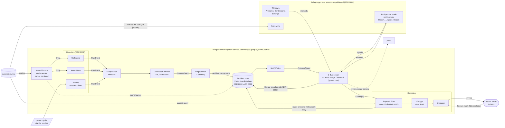

# RFC 0001: Daemon redesign

| | |
|---|---|
| **Status** | Draft, open questions pending (see [§10](#10-open-questions)) |
| **Created** | 2026-09-30 |
| **Affects** | `crates/daemon`, `crates/gui`, `crates/report`, `crates/utils`, `module.nix`, report server API |
| **Supersedes** | — |
| **References** | [`docs/references.md`](../references.md): external sources (systemd, kernel, Nix, standards, libraries), pinned to the shipped versions |
| **Decisions** | [ADR 0001](../adr/0001-problem-centric-daemon.md)–[ADR 0009](../adr/0009-store-viewer-data.md) ([ADR 0004](../adr/0004-opt-in-automatic-micro-reports.md) reopened); proposed: [ADR 0010](../adr/0010-nix-problem-scope.md) (Nix scope), [ADR 0011](../adr/0011-detector-contract.md) (detector contract), [ADR 0012](../adr/0012-shadow-mode-rollout.md) (shadow rollout), [ADR 0013](../adr/0013-problem-fingerprint.md) (fingerprint). Where this RFC and an ADR differ, the ADR wins |

## 1. Summary

Rebuild the Relago daemon around a **problem store**. Today it forwards individual journal entries straight to the desktop. The redesigned daemon will:

1. detect problems with precise, testable **collectors** keyed on journal `MESSAGE_ID`s,
2. **fingerprint and de-duplicate** them, so one recurring crash is one problem with a counter,
3. assign a **severity** and apply a **notification policy**, so the Relago window stops popping up constantly,
4. produce **micro reports** (a few KiB, scoped to the crash) by default, and full reports only on request,
5. own all privileged work (journal access, keys, encryption, upload), leaving the Relago app a thin D-Bus client ([ADR 0008](../adr/0008-single-relago-app.md)).

## 2. Motivation

The current architecture is the root cause of most problems found in the codebase review:

| Problem | Root cause |
|---|---|
| Wrong crash classification | Detection keys on `SYSLOG_IDENTIFIER` and field *presence*; the first plugin that parses wins |
| Service failures / OOM never reported | Only coredumps reach the GUI |
| Window pops up constantly | No memory of past crashes: every journal entry becomes a notification and a new window |
| Crashes lost while no GUI runs | `CrashQueue` exists but is never filled |
| Huge, privacy-invasive reports | GUI collects the *entire* journal and `/etc/xinux` (or `/etc/nixos`) |
| Permission failures / world-readable keys | GUI (desktop user) does privileged work in `/var/lib/relago` |
| Daemon links GTK | `daemon` depends on `gui` for the `Modal` struct |
| Untestable | Detection is tied to a live `systemd::Journal` |

Patching these one by one keeps the flawed data flow (journal entry -> signal -> window). A redesign changes the flow itself.

## 3. Goals and non-goals

**Goals**
- Correct detection of coredumps, unit failures, and OOM kills (systemd-oomd and kernel), plus the kernel, hardware, storage and NixOS problems picked in §5.5.
- At most one notification per distinct problem per policy window.
- No crashes are lost when no desktop session is running.
- A default report under ~16 KiB that contains only data relevant to the crash.
- All privileged work runs in the daemon as `relago`. The Relago app runs unprivileged.
- Collectors and policy are unit-testable without a live journal.
- Can be delivered incrementally, with no big-bang rewrite.

**Non-goals (for this RFC)**
- Symbolising stack traces or shipping debug info (see Q6).
- Detecting Nix build/evaluation failures (a future collector; the design must allow it). [RFC 0004](0004-nix-problems.md) and [ADR 0010](../adr/0010-nix-problem-scope.md) (proposed) revisit this.
- Applying fixes or configuration patches issued by Xinux support. The Xinux system update mechanism does that; Relago only stores and shows a problem's resolution status (§9.2).
- Server-side analytics/UI beyond the endpoints needed here.
- Non-systemd systems.

## 4. Architecture

The detector pipeline follows [RFC 0002 §3.2](0002-detectors.md#32-pipeline). The app's two data paths, D-Bus for problems and direct journal reads for logs, follow [RFC 0003 §3](0003-relago-app.md#3-architecture).



A PlantUML version is in [`diagrams/0001-daemon-architecture.puml`](diagrams/0001-daemon-architecture.puml) ([SVG](diagrams/0001-daemon-architecture.svg)). Keep it in sync when this diagram changes.

### 4.1 Crate layout

| Crate | Responsibility | Depends on |
|---|---|---|
| `relago-proto` (new) | `Problem`, `ProblemId`, `Severity`, `Fingerprint`, D-Bus interface + proxy definitions | `serde`, `zbus` |
| `relago-journal` (new, [RFC 0003](0003-relago-app.md) §3.1) | `Entry`, journal reader helpers, scrubber, NDJSON export; shared by collect, report, app | — |
| `relago-collect` (new, from `daemon/crash.rs` + `crash-event`) | `Collector` trait, built-in collectors | `relago-proto`, `relago-journal` |
| `relago-daemon` | Journal source, store, policy, report builder orchestration, uploader, D-Bus server | `proto`, `journal`, `collect`, `report`, `utils` |
| `relago-report` | Micro/full report assembly per [ADR 0007](../adr/0007-report-structure.md), encryption (library, no global config) | `proto`, `journal` (scrubber) |
| `relago-app` (was `gui`) | Relago app: problems, logs, reporting, background notifications ([ADR 0008](../adr/0008-single-relago-app.md)); D-Bus client only | `proto`, `journal`, `relm4` |
| `relago` (cli) | Subcommands, config loading | all |

The daemon no longer depends on GTK. The app no longer depends on `report`, `reqwest`, or `pgp`.

Crate dependencies are drawn in [Mermaid](diagrams/0001-daemon-architecture.md#crate-layout-rfc-0001-41) and [PlantUML](diagrams/0001-crate-layout.puml) ([SVG](diagrams/0001-crate-layout.svg)).

## 5. Detection

### 5.1 Journal source

- One reader for the whole daemon. Matches are installed **before** seeking.
- The last processed **journal cursor** is persisted in the store. On restart the daemon resumes from the cursor, so crashes that happen while it is down or restarting are not lost. On first start it seeks to the tail.
- Each entry is converted into a plain `Entry { fields: BTreeMap<String, Vec<u8>>, realtime_usec, cursor }` (defined in `relago-journal`) before any detector sees it. Detectors never touch `systemd::Journal`.

### 5.2 Collector trait

```rust
pub trait Collector: Send + Sync {
    /// Stable identifier, stored with the problem ("coredump", "unit-failure", …).
    fn kind(&self) -> ProblemKind;
    /// Journal matches this collector needs; the source ORs all collectors' groups.
    fn matches(&self) -> &'static [(&'static str, &'static str)];
    /// Return an event only if this entry is really ours. Must verify MESSAGE_ID itself.
    fn parse(&self, entry: &Entry) -> Option<ProblemEvent>;
}
```

[RFC 0002 §3.1](0002-detectors.md#31-detector-types) refines this into four detector types (Collector, Assembler, Probe, Correlator); the signatures there are authoritative.

Every collector runs on every matching entry (no "first match wins"). A collector checks its own `MESSAGE_ID`, so there is no cross-classification.

The `crash-event` derive macro can stay as an implementation helper for field extraction, but the generated `detect()` must check the declared filters.

### 5.3 Built-in collectors

> This table is an overview of the core detectors. [RFC 0002 §5](0002-detectors.md#5-detector-specifications) is authoritative, and kind names follow [ADR 0007](../adr/0007-report-structure.md) §4. Message IDs below are from `systemd/sd-messages.h`; [RFC 0002 §4.1](0002-detectors.md#41-systemd-message-ids) lists them with verified values and links to their definitions. Each collector needs a recorded fixture before merge.

| Collector | Match | Key fields | Notes |
|---|---|---|---|
| `coredump` | `MESSAGE_ID=fc2e22bc6ee647b6b90729ab34a250b1` (`SD_MESSAGE_COREDUMP`) | `COREDUMP_EXE`, `COREDUMP_PID`, `COREDUMP_UID`, `COREDUMP_SIGNAL`, `COREDUMP_UNIT`/`COREDUMP_USER_UNIT`, `COREDUMP_CMDLINE`, `COREDUMP_FILENAME`, `MESSAGE` (contains stack trace when available) | UID tells us which user to notify |
| `unit_failure` | `SD_MESSAGE_UNIT_FAILURE_RESULT` (RFC 0002 SVC-1/SVC-2) | `UNIT` or `USER_UNIT`, `UNIT_RESULT`, `_SYSTEMD_INVOCATION_ID` | Correlate with later "started" of the same unit to detect transient failures (see §6.2) |
| `oom_kill` (systemd-oomd) | `SD_MESSAGE_UNIT_OOMD_KILL` | `UNIT`, memory pressure fields | Victim is `UNIT`, **not** `_PID`/`_COMM` |
| `oom_kill` (kernel) | `SD_MESSAGE_UNIT_OUT_OF_MEMORY` + kernel `oom-kill:` summary line (RFC 0002 MEM-2) | unit; pid, comm, uid, constraint from the kernel line | Both signals merged into one event (RFC 0002 §3.4) |

Further collectors are listed in the problem catalogue ([§5.5](#55-problem-catalogue)); which of them to build is decided there.

### 5.4 `ProblemEvent`

A `ProblemEvent` is a `RawEvent` ([RFC 0002 §3.3](0002-detectors.md#33-rawevent)) that has passed suppression and correlation. The key fields:

```rust
pub struct ProblemEvent {
    pub detector: DetectorId, // "CRASH-1", …
    pub kind: ProblemKind, // one of the 15 kinds in ADR 0007 §4 (SVC-1/SVC-2 and MEM-1/MEM-2 share a kind)
    pub at: SystemTime,
    pub boot_id: BootId,
    pub owner: Owner,    // User(uid) | System (ADR 0003)
    pub subject: Subject,  // Exe{path, package} | Unit | Device | Mount | Kernel | Generation
    pub severity_hint: Severity,
    pub dedup_key: String, // occurrence identity
    pub fp_parts: Vec<String>,  // fingerprint inputs
    pub details: Details,  // closed per-kind variant (ADR 0007 §4)
    pub evidence: Vec<Cursor>,  // all journal cursors used; stored per occurrence (ADR 0009)
}
```

**`NixPackage`** is where NixOS pays off. `COREDUMP_EXE=/nix/store/abcd…-firefox-131.0/bin/firefox` gives us name `firefox` and version `131.0` without any package database. Paths outside `/nix/store` get `package = None`.

### 5.5 Problem catalogue

The problems selected for the first release. Each row becomes one detector. Problems that were considered but not selected (later, not planned and not recommended) are listed in [`docs/plan.md`](../plan.md), with their original rows. Several detectors can share a problem kind (e.g. SVC-1/SVC-2 -> `unit_failure`); the kinds are listed in [ADR 0007](../adr/0007-report-structure.md) §4. How each detector works is specified in [RFC 0002: Detectors](0002-detectors.md). This table decides the scope.

**Scope decision (2026-09-30; recorded here, no ADR yet):** the 18 detectors below are in the first release. Five of them (CRASH-1, CRASH-2, SVC-1, MEM-1, MEM-2) were part of the original design; the other 13 were picked from the catalogue. Four were picked although first recommended for after the first release: HW-2, PWR-1, DISK-3 and NIX-3. Items marked Later (PWR-2, KERN-3) or not planned (CRASH-3, SESS-2, KERN-4, NIX-4, and the not-recommended NET and SEC entries) are listed in [`docs/plan.md`](../plan.md).

**Legend**
- **ID:** a group prefix and a number. CRASH = process crashes, SVC = services, SESS = desktop session, MEM = memory, KERN = kernel, HW = hardware, DISK = storage, PWR = power and shutdown, NIX = NixOS and Nix, NET = network, SEC = security.
- **Severity:** initial estimate (C = Critical, H = High, L = Low). The per-detector defaults in RFC 0002 §5 take precedence (e.g. HW-2 corrected errors, PWR-1 and NIX-3 start at L).
- **Noise:** how likely the signal fires for harmless events. **Effort:** S ≈ days, M ≈ 1–2 weeks, L ≈ more, or needs new infrastructure.
- Message IDs and kernel message patterns **must be verified** against the systemd/kernel versions in nixpkgs, with a fixture per collector.

#### CRASH: Process crashes

| ID | Problem | Detection | Sev. | Noise | Effort |
|---|---|---|---|---|---|
| CRASH-1 | Native app/daemon crash (segfault, abort) | `systemd-coredump` journal entry (`SD_MESSAGE_COREDUMP`) | C (user) / H (system) | Low | S |
| CRASH-2 | Crash loop (same binary crashing repeatedly) | Derived: fingerprint `count` over time window, not a separate source | raises CRASH-1 | Low | S |

#### SVC: Services

| ID | Problem | Detection | Sev. | Noise | Effort |
|---|---|---|---|---|---|
| SVC-1 | System service failed | Unit result message IDs (`UNIT`, `UNIT_RESULT`), with "did not recover" delay (§6.2) | H / L | Medium (mitigated by delay) | S |
| SVC-2 | User service failed (PipeWire, portals, GNOME services) | Same message IDs with `USER_UNIT`, from user managers | H (owner) / L | Medium | S |

#### SESS: Desktop session

| ID | Problem | Detection | Sev. | Noise | Effort |
|---|---|---|---|---|---|
| SESS-1 | Desktop session crashed (user thrown back to login screen) | `gnome-shell`/compositor coredump (CRASH-1) **plus** GDM/logind "session closed unexpectedly" correlated within seconds | C | Low | M |

#### MEM: Memory

| ID | Problem | Detection | Sev. | Noise | Effort |
|---|---|---|---|---|---|
| MEM-1 | systemd-oomd killed a unit | `SD_MESSAGE_UNIT_OOMD_KILL`, victim from `UNIT` | C (user app) / H | Low | S |
| MEM-2 | Kernel OOM killer | `_TRANSPORT=kernel`, `Out of memory: Killed process <pid> (<comm>)` | C / H | Low | S |

#### KERN: Kernel

| ID | Problem | Detection | Sev. | Noise | Effort |
|---|---|---|---|---|---|
| KERN-1 | Kernel panic in the previous boot | `systemd-pstore` copies `/sys/fs/pstore` to `/var/lib/systemd/pstore` at boot; collector reads new dumps on start (verify pstore is enabled on Xinux) | C | Very low | M |
| KERN-2 | Kernel oops / `BUG:` / `WARNING: CPU:` | Kernel messages with these prefixes; fingerprint on the function in `RIP:` / first call-trace frame | H | Medium (some drivers WARN often) | M |

#### HW: Hardware

| ID | Problem | Detection | Sev. | Noise | Effort |
|---|---|---|---|---|---|
| HW-1 | GPU hang / reset | Driver-specific kernel messages: i915/xe `GPU HANG`, amdgpu `ring … timeout` / `GPU reset`, NVIDIA `Xid` | H | Low | M |
| HW-2 | Hardware errors (MCE, PCIe AER, ECC) | Kernel `mce:` / `Machine check` / `AER:` messages, or `rasdaemon` if installed | H | Low (but corrected errors are frequent) | M |

#### DISK: Storage

| ID | Problem | Detection | Sev. | Noise | Effort |
|---|---|---|---|---|---|
| DISK-1 | Filesystem errors / remounted read-only / I/O errors | Kernel `EXT4-fs error`, `BTRFS error`, `Remounting filesystem read-only`, `I/O error, dev …` | C | Low | S |
| DISK-2 | Low disk space (`/`, `/nix/store`, `/boot`) | Periodic `statvfs` check (not the journal); thresholds e.g. < 5 % or < 2 GiB, `/boot` < 50 MiB | H | Low | S |
| DISK-3 | Disk health (SMART / NVMe errors) | `smartd` journal messages if `services.smartd` is enabled; NVMe kernel errors | H | Low | M |

#### PWR: Power and shutdown

| ID | Problem | Detection | Sev. | Noise | Effort |
|---|---|---|---|---|---|
| PWR-1 | Unclean shutdown / hard reset | On start: previous boot's journal has no shutdown message (`SD_MESSAGE_SHUTDOWN`), and no pstore dump (else it's KERN-1) | H | Medium (users do hold the power button) | S |

#### NIX: NixOS and Nix

| ID | Problem | Detection | Sev. | Noise | Effort |
|---|---|---|---|---|---|
| NIX-1 | System activation failed (`nixos-rebuild switch` / `switch-to-configuration`) | `switch-to-configuration` journal output ("the following units failed", non-zero exit), or the unit wrapping it on newer NixOS | H | Low | M |
| NIX-2 | Automatic upgrade failed | `nixos-upgrade.service` failure (`system.autoUpgrade`); a special case of SVC-1 with its own kind and wording | H | Low | S |
| NIX-3 | Booted an older generation than the newest (likely rollback after a bad update) | On start: compare `/run/booted-system` with the newest `/nix/var/nix/profiles/system-*-link` | H | Low (also fires on deliberate rollbacks) | S |

> The NixOS group is extended by [RFC 0004](0004-nix-problems.md) and [ADR 0010](../adr/0010-nix-problem-scope.md) (proposed): NIX-4 is redefined there and NIX-5 to NIX-18b are added.

#### Former IDs

Until 2026-11 the catalogue used letter groups. Old notes may still use them:

| Old | New | Old | New | Old | New |
|---|---|---|---|---|---|
| A1–A3 | CRASH-1 to CRASH-3 | D1, D2 | KERN-1, KERN-2 | E3 | PWR-1 |
| B1, B2 | SVC-1, SVC-2 | D3 | HW-1 | E4 | DISK-3 |
| B3 | SESS-1 | D4 | KERN-3 | F*n* | NIX-*n* (sub-letters kept) |
| B4 | PWR-2 | D5 | HW-2 | G1 | NET-1 |
| B5 | SESS-2 | D6 | KERN-4 | G2, G3 | SEC-1, SEC-2 |
| C1, C2 | MEM-1, MEM-2 | E1, E2 | DISK-1, DISK-2 | | |

#### Impact of the catalogue on the rest of the design

- **Sources beyond the journal:** KERN-1 (pstore directory), DISK-2 (`statvfs`), PWR-1 (previous boot's journal) and NIX-3 (profile symlinks) are handled by the `Probe` detector type, run on start and on a timer ([RFC 0002 §3.1](0002-detectors.md#31-detector-types)).
- **Boot-time collectors:** KERN-1, PWR-1 and NIX-3 run once on daemon start and describe the *previous* boot. They run as one boot batch, and their notifications wait for an eligible session (RFC 0002 §3.9); the boot grace period (§6.3) still applies.
- **Kernel parsers:** KERN-2, HW-1, HW-2 and DISK-1 (and KERN-3, if selected later) parse kernel message text, the most fragile part. Each gets fixtures from several kernel versions, and unknown formats fall back to "no event" rather than a wrong event.
- **Micro-report fields per kind:** each collector declares which extra fields go into the micro report (e.g. HW-1: driver and GPU model; DISK-1: filesystem type and device model, **no** file paths).

## 6. De-duplication and severity

### 6.1 Fingerprint

> [ADR 0013](../adr/0013-problem-fingerprint.md) (proposed) replaces this section: the fingerprint is built from the kind and per-kind identity parts, with variants and a regression rule. The text below is the original sketch.

```
fingerprint = sha256(kind || package.name || exe basename || signal|| top-5 frame function names)
```

- The package **version is deliberately excluded**, so the same bug across updates counts as one problem. The store records versions seen.
- With no stack frames, the fingerprint falls back to `kind || package || exe || signal` (unit failures: `kind || unit || UNIT_RESULT`).
- The algorithm is versioned (`fp_v1:`) so it can change without corrupting history.

### 6.2 Severity

| Severity | Rule (first match wins) | Default action |
|---|---|---|
| **Critical** | Crash or OOM kill of a user's application; session crash; kernel panic; data-loss risk (filesystem read-only, uncorrected hardware error, failing disk) | Notify the owner (user problems) or `wheel` (system problems) |
| **High** | System service failed and did **not** recover within 60 s, or keeps failing; kernel oops, GPU hang, filesystem errors, low disk space, failed activation/upgrade | Notify the owner or `wheel` |
| **Low** | Failure that recovered on its own; corrected hardware errors; kernel warnings; unclean shutdown; older generation booted without evidence of a bad update | Record only |
| **Info** | Fingerprint on the ignore list, or already reported and acknowledged by server | Record only |

The exact rule for each detector is in RFC 0002 §5. Routing follows [ADR 0003](../adr/0003-problem-visibility.md), and only High and Critical notify by default ([ADR 0005](../adr/0005-notification-threshold.md)).

Severity is computed on insert and **re-evaluated** when a problem gets new occurrences (e.g. Low -> High when a unit keeps failing). Evaluation of "did not recover" is delayed (a timer per pending unit failure) rather than decided on the first entry.

### 6.3 Notification policy

A notification is sent only if **all** of these hold:

1. Severity >= the configured threshold (`[policy] notify_min_severity`, default `high`, ADR 0005).
2. This fingerprint has not been notified in the last `renotify_after` (default 24 h). Later occurrences only increment the counter.
3. The global rate limit is not exceeded (default 3 notifications / 10 min / user).
4. The system is past the boot grace period (default 120 s after the daemon starts in a new boot; RFC 0002 §3.5), so boot-time noise is batched into one "N problems detected" notification.
5. The fingerprint, package, or unit is not on the user's or admin's ignore list.

**Delivery.** A notification counts as sent only when an eligible session receives it. Until then the problem is *pending delivery*, `last_notified` stays unset, and the `renotify_after` window starts at delivery (RFC 0002 §3.9, rule 4; RFC 0003 §7).

The notification carries actions **"Report…"**, **"Ignore"**, and **"Details"**. It is shown by the Relago app's background mode (ADR 0008). A window opens **only** when the user clicks an action, and it opens the problem's page in the Relago app (RFC 0003 §4.1).

### 6.4 Consent (Q4, proposed in [ADR 0004](../adr/0004-opt-in-automatic-micro-reports.md): opt-in automatic micro reports; reopened, see §10)

- **First run.** When the first Critical/High problem for a user appears, the Relago app shows a one-time consent dialog instead of a normal notification: *"Automatically send small crash summaries to Xinux?"* with a "What is sent?" link showing an example micro report. The answer is stored per uid in `consent.json`.
- **Opted in.** Micro reports for that user's problems are sent automatically, without a window. The notification becomes informational ("Firefox crashed; a summary was sent") with a "Details…" action. Only the **first** occurrence of a fingerprint is sent; later occurrences update the count via the server (§9.2).
- **Opted out or undecided.** Nothing is sent until the user clicks "Report…".
- **Full reports always ask**, regardless of consent.
- **Pseudonymous, not anonymous.** The consent dialog states that reports are linked to this device's Reporter-ID, so that Xinux support can prepare fixes for it (§3, §9.2). The report body itself contains no identifiers (ADR 0007 §2).
- **System problems** (shown to `wheel`, ADR 0003) follow the consent of the admin who acts on them; they are never auto-sent from a non-admin's consent.
- The consent can be changed at any time in the Relago app's Settings (RFC 0003 §4.4), and with `relago consent on|off`. The NixOS module can set a system-wide default and lock it (`services.relago.consent.default`, `…locked`), for managed installs.

All thresholds live in `config.toml` under `[policy]` and are exposed as NixOS module options.

## 7. Problem store

**Decision (Q1): JSON files** ([ADR 0002](../adr/0002-json-file-problem-store.md), layout amended by [ADR 0009](../adr/0009-store-viewer-data.md)). No new native dependency, and the files are human-readable and easy to debug with `jq`. All timestamps are integer microseconds since the Unix epoch ([ADR 0006](../adr/0006-data-formats.md)).

### 7.1 Layout

```
/var/lib/relago/  dataDir or StateDirectory=relago, mode 0700, owner relago
├── state.json     journal cursor, pending evaluations, boot ledger, detector state etc...
├── ignores.json  
├── consent.json   
└── problems/
    └── fp_v1_3f9a…c2/  one directory per fingerprint, `:` replaced by `_`
        ├── problem.json  summary + occurrence ring buffer loaded at start
        ├── excerpts/<occurrence>.json scrubbed journal excerpt (first + 3 most recent occurrences); loaded on demand
        └── sent/
            ├── <report_id>.micro.json     exact micro report sent
            └── <report_id>.manifest.json  manifest of a sent full report (archived before sending)
```

`state.json`:

```jsonc
{
  "schema": 1,
  "journal_cursor": "…",
  "pending_evals": [ … ],                 // e.g. SVC-1 recovery checks; closed as interrupted after a reboot (RFC 0002 §3.9)
  "boots": [                             // boot ledger, newest last, last 20 (RFC 0002 §3.9)
    { "boot_id": "…", "started_at": 1727700000000000, "kernel": "6.12.40",
      "system_hash": "b3…", "nixos_version": "25.11.20260901.abcdef0", "generation": 412 }
  ],
  "detectors": {                         // private, versioned state per detector (ADR 0011, proposed)
    "KERN-1": { "schema": 1, "state": { "seen_records": ["…"] } }
  },
  "machine_secret": "…"                  // key for private fingerprint parts; never sent (ADR 0013, proposed)
}
```

`problems/<fingerprint>/problem.json`:

```jsonc
{
  "schema": 1,
  "fingerprint": "fp_v1:3f9a…c2",
  "kind": "coredump",                     // ADR 0007 §4 kind
  "detector": "CRASH-1",
  "severity": "critical",
  "owner": { "type": "user", "uid": 1000 },   // or { "type": "system" } (ADR 0003)
  "subject": { "type": "exe", "package": { "name": "firefox", "version": "131.0" }, "exe": "bin/firefox" },
  "first_seen": 1727700000000000, "last_seen": 1727786400000000, "count": 14,
  "versions": ["130.0", "131.0"],
  "looping": false,
  "last_notified": 1727700050000000,
  "state": "reported",                    // new | notified | reported | ignored | known | resolved | shadow
  "server_ref": "…",
  "resolution": {                         // from the server, or null (§9.2)
    "status": "fix_available",            // fix_available | fixed_in_update | not_a_bug | needs_info
    "note": "…", "updated_at": 1727900000000000 },
  "occurrences": [                        // ring buffer, newest last, max 20
    { "id": 14, "at": 1727786400000000, "boot_id": "…", "version": "131.0",
      "dedup_key": "…", "cursors": ["…", "…"], "has_excerpt": true,
      "event": { /* full ProblemEvent */ } }
  ],
  "sent": [                               // index of sent/ (ADR 0009)
    { "report_id": "7f1c…", "tier": "micro", "sent_at": 1727700060000000,
      "server_status": "new", "send_mode": "auto" }
  ]
}
```

- `uid` is stored locally for routing (ADR 0003) but is never written into a report (ADR 0007 §2).
- `resolved` is used by problems that can clear (e.g. DISK-2 low disk space). `shadow` marks problems from detectors in shadow mode (RFC 0002 §3.7, [ADR 0012](../adr/0012-shadow-mode-rollout.md)).

### 7.2 Rules

- **Single writer.** Only the daemon writes. It loads every `problem.json` into an in-memory `HashMap<Fingerprint, Problem>` at start (hundreds of small files, well under a second) and serves D-Bus reads from memory. Excerpts and sent-report copies are read from disk on demand.
- **Atomic writes.** Write to `<name>.json.tmp`, `fsync`, then `rename`, then `fsync` the directory. A crash mid-write leaves the old file intact. Leftover `*.tmp` files are removed at start.
- **Write-behind.** A changed problem is marked dirty and flushed at most once per second, and on shutdown. A crash loop (e.g. 100 coredumps/min) therefore does not turn into 100 writes/min.
- **Cursor after data.** `state.json` (journal cursor) is written *after* the problem files it covers. After a daemon crash the worst case is re-processing a few entries. That is harmless, because a duplicate occurrence has the same `dedup_key` and is skipped (RFC 0002 §3.4).
- **Corrupt files.** A file that fails to parse is moved to `problems/.corrupt/` and logged. A problem directory without `problem.json` is incomplete and is removed at start (`problem.json` is always written last). The daemon never refuses to start because of one bad file.
- **Retention.** Keep at most 20 occurrences per problem; delete problems whose `last_seen` is older than 90 days; cap at 1 000 problems; cap the whole store at **64 MiB**, evicting in the order of ADR 0009 (excerpts of resolved/ignored problems, sent copies older than 90 days, then oldest problems). All configurable; defaults pending Q8.
- **Schema changes.** Every file carries `schema`. The loader upgrades old versions in memory and rewrites them on the next flush.
- **Encapsulation.** The store sits behind a `ProblemStore` trait, so moving to SQLite later (if querying needs grow) touches one module.

## 8. Reports

### 8.1 Micro report (default)

Built from the store plus a **scoped** journal query. Target ≤ 16 KiB, hard limit 64 KiB. The structure is fixed in [ADR 0007](../adr/0007-report-structure.md):

- **Envelope** (same for every problem kind): `schema` (`relago.micro/1`), `report_id`, `created_at`, `client`, `problem` (fingerprint, kind, detector, severity, owner, occurrences, subject), `system`, `journal` (≤ 50 scrubbed lines, scoped per kind), and `context`.
- **`details`**: a closed, per-kind object (for example signal and frames for a coredump, or failed units for an activation failure). It is defined by each detector's `Details` variant (RFC 0002 §3.3).

**Explicitly excluded:** hostname, machine-id, boot-id, uid, usernames, IP and MAC addresses, network interfaces, other units' logs, NixOS configuration files, `COREDUMP_CMDLINE` arguments (only `argv[0]` is kept), environment. Free text is scrubbed (ADR 0007 §6).

### 8.2 Full report (on request)

- Sent when the server asks for it (`want_full`, §9.2) or when the user explicitly chooses "Send full report" in the Relago app (`requested_by: server | user`, ADR 0007 §3.1). It is **always** confirmed by the user, with per-category opt-in ([ADR 0004](../adr/0004-opt-in-automatic-micro-reports.md)).
- Includes a larger journal window, extended system info, and optionally the core file and a **redacted** NixOS config. The scope, caps and redaction rules are in ADR 0007 §3.2–3.4.
- When the NixOS config is included, `manifest.json` also records the config root, its git `HEAD` if it is a repository, and the sha256 of each **original** (pre-redaction) file. Support can then prepare a patch against the exact base. Relago never applies such patches; the Xinux system update mechanism does (§3).
- Format ([ADR 0006](../adr/0006-data-formats.md)): `tar` -> `zstd` -> OpenPGP SEIPDv2, streamed to one file in a private temp dir and deleted after upload. No compression inside the archive.

The archive layout is fixed in [ADR 0007](../adr/0007-report-structure.md) §3:

```
report-<report_id>.tar.zst.pgp
├── manifest.json     relago.full/1     index, always the first entry
├── micro.json        relago.micro/1    the micro report (a full report is a superset of it)
├── system.json       relago.system/1   extended system info, allow-listed
├── journal.ndjson    relago.journal/1  scoped journal, ≤ 200 000 lines / 64 MiB
├── core.zst          optional, opt-in
└── nixos-config.tar  optional, opt-in, redacted
```

- The journal is written **line by line** into a staged file in a private temp dir, then streamed into the archive after the manifest (ADR 0007 §3.1). The server reads it line by line too. Neither side holds the whole report in memory. Readers skip and count lines they cannot parse.
- Non-UTF-8 journal values are encoded as `{"b64": "…"}`. Timestamps are integer microseconds since the Unix epoch.

### 8.3 Preview

`GetReportPreview(id, full)` returns exactly the JSON that will be sent, after scrubbing (ADR 0007 §6). The problem page in the Relago app displays it (RFC 0003 §4.1), replacing `get_log_tail`.

## 9. D-Bus API and server protocol

Two APIs carry a version 1: the existing server HTTP API (`/v1`) and the new D-Bus API (`Daemon1`, "D-Bus API v1"). These documents always say which one they mean.

### 9.1 D-Bus: `uz.xinux.relago.Daemon1` at `/uz/xinux/relago/Daemon1` (system bus)

> **Superseded by [RFC 0003](0003-relago-app.md) §5**, the full, versioned D-Bus API v1 (paging, filters, occurrences, excerpts, evidence, sent reports, update/remove signals). The table below is the original minimal sketch.

| Member | Kind | Caller | Notes |
|---|---|---|---|
| `ListProblems(min_severity) -> a(…)` | method | agent | Filtered to problems visible to the caller's uid (see Q3) |
| `GetProblem(id) -> (…)` | method | agent | |
| `GetReportPreview(id, full: b) -> s` | method | agent | JSON |
| `Submit(id, context: s, full: b) -> job_id` | method | agent | Daemon builds + uploads |
| `Ignore(fingerprint, scope)` | method | agent | `scope` = user / system (system needs polkit) |
| `Register()` | method | agent | polkit `uz.xinux.relago.register`, admin only |
| `ProblemAdded(id, severity, uid)` | signal | daemon | Agent filters by its own uid |
| `JobProgress(job_id, fraction, stage)` | signal | daemon | Real progress |
| `JobFinished(job_id, ok, message)` | signal | daemon | |

Callers are identified with `GetConnectionUnixUser` on the bus. We do not rely on group membership ([ADR 0003](../adr/0003-problem-visibility.md)).

### 9.2 Server (decision Q2: add `/v2`; no ADR yet)

```
POST /v2/problems                 micro report         ->  200 { ref, status: "known" | "new", want_full: bool }
POST /v2/problems/{ref}/occurrences { count, versions } ->  204          (repeat occurrences, no payload)
POST /v2/problems/{ref}/full      full report          ->  200
GET  /v2/problems/status?refs=…   (daily, only for problems in state `reported`)  ->  200 { ref: resolution, … }
```

Authentication stays `Reporter-ID` + encrypted payload for now. Signing requests with the client key generated at registration was a follow-up. Because the Reporter-ID is now the identity used to target fixes, signing is **required before the Xinux system update mechanism relies on it** (§3). The client key currently exists but is unused.

- Any `/v2` problem response may include `resolution` (`fix_available`, `fixed_in_update`, `not_a_bug`, `needs_info`, with a note). Relago stores it and shows it in the app; it never installs anything (§3).

- `status: known` -> mark the problem `known`, lower future severity to Info, and send only occurrence counts from then on.
- `want_full: true` -> the problem page in the Relago app offers "Send more details".
- The server's `/v1` API stays until all clients migrate.

## 10. Open questions

| # | Question | Decision | Where applied |
|---|---|---|---|
| **Q1** | Problem store backend | **JSON files**, one directory per fingerprint (ADR 0009), behind a `ProblemStore` trait | §7 |
| **Q2** | Can the server API change now? | **Yes, add `/v2`** with micro reports, occurrence updates and server-side dedup | §9.2, Phase 5 |
| **Q3** | Who sees which problems? | **Owner by uid; system problems go to `wheel` members** | §6.2, §9.1, RFC 0003 §5 |
| **Q5** | Default notification threshold | **High and above** (Critical + High notify; Low/Info recorded silently) | §6.2, §6.3 |
| **Q7** | Is the per-user agent still needed? | **No:** merged into the Relago app's background mode ([ADR 0008](../adr/0008-single-relago-app.md)) | §4, §6.3, RFC 0003 §7 |

### Still open

| # | Question | Options | Initial recommendation |
|---|---|---|---|
| **Q4** | Consent model (reopened 2026-11-05; [ADR 0004](../adr/0004-opt-in-automatic-micro-reports.md) is Proposed again until its user stories are analysed) | (a) Opt-in automatic micro reports after a first-run dialog; full reports always ask · (b) Ask for every problem · (c) Automatic by default, opt-out | (a), the current text of §6.4, pending the user-story analysis |
| **Q6** | Stack traces | (a) Use the trace `systemd-coredump` already logs (needs `elfutils`; often unsymbolised on NixOS) · (b) Also run `gdb`/`eu-stack` on the core file · (c) Rely on server-side symbolication with debuginfod | (a) now, (c) later; fingerprint must work without frames |
| **Q8** | Retention and privacy of local store | defaults for occurrences kept, age limit, whether user can "Clear history"; now also excerpts and sent-report copies (ADR 0009) | 20 occurrences / 90 days, clear-history action in UI |

## 11. Migration plan

| Phase | Deliverable | Ships independently? | Solves (§2) |
|---|---|---|---|
| **0** | Hotfixes on current code: exit code, SIGHUP, key/report permissions | yes | Permission failures / world-readable keys (key and report permissions only) |
| **1** | `relago-proto` + `relago-collect`; core collectors **CRASH-1, SVC-1, SVC-2, MEM-1, MEM-2** with fixture tests; old daemon uses new collectors behind the current `Modal` signal, with `Modal` moved from `gui` into `relago-proto` so the daemon no longer links GTK | yes | Wrong crash classification; Service failures / OOM never reported; Daemon links GTK; Untestable (partly) |
| **2** | Problem store (ADR 0002/0009 layout), fingerprinting, severity, notification policy, journal cursor persistence, crash-loop detection (**CRASH-2**); the read-only part of `Daemon1` D-Bus API v1 (RFC 0003 §5, capability `problems`) next to the old interface; the existing `relago gui` agent shows notifications with actions (transitional, replaced in RFC 0003 app phase 4) | yes: **popup problem solved here** | Crashes lost while no GUI runs; Window pops up constantly |
| **2a** | `Probe` trait + timer; boot-time and periodic probes: **DISK-2** low disk space, **KERN-1** kernel panic (pstore), **PWR-1** unclean shutdown, **NIX-3** older generation booted | yes | — |
| **2b** | Kernel message parsers with multi-kernel fixtures: **KERN-2** oops/BUG/WARN, **HW-1** GPU hang, **HW-2** hardware errors, **DISK-1** filesystem/I/O errors | yes | — |
| **2c** | NixOS and session collectors: **NIX-1** activation failed, **NIX-2** auto-upgrade failed, **SESS-1** session crashed (correlates CRASH-1 + logind), **DISK-3** disk health | yes | — |
| **3** | Micro report builder (ADR 0007) + preview in the existing reporter window; uploads still from the GUI (transitional) | yes | Huge, privacy-invasive reports (micro reports by default) |
| **4** | Move report building, encryption, upload, registration into daemon; the rest of `Daemon1` D-Bus API v1 (RFC 0003 §5, capability `reporting`); polkit; reporting moves into the Relago app (RFC 0003 app phases 2–5) | yes | Permission failures / world-readable keys; Huge, privacy-invasive reports (full reports built by the daemon from scoped data) |
| **5** | Server `/v2` integration (known/want_full, occurrence updates, auto-send per §6.4 if Q4 keeps it), full-report flow | yes; server `/v2` must land first | Huge, privacy-invasive reports (streamed full reports, single compression) |
| **6** | Delete old code paths (`CrashQueue`, `Modal`, `get_log_tail`, `core.rs`, `notify.rs`, `data/`, the `reporter` and `gui` subcommands per ADR 0008, the report layout of the server's `/v1` API, per ADR 0007) | yes | — |

Each phase ends with passing `nix flake check`, including a NixOS VM test from Phase 2 on: enable module -> segfault a test binary 5× -> assert exactly one `ProblemAdded` and `count = 5`.

## 12. Testing strategy

- **Collector fixtures:** real entries captured with `journalctl -o export`, checked into `crates/collect/test/fixtures/`, one positive and several negative cases per collector (e.g. "Started foo.service" must **not** be a unit failure).
- **Policy tests:** a table-driven sequence of events with a fake clock -> expected notifications.

## 13. Risks

| Risk | Mitigation |
|---|---|
| Message IDs / field names differ across systemd versions | Fixtures per systemd version in nixpkgs; collectors tolerate missing optional fields |
| Unsymbolised stacks make fingerprints too coarse (different bugs merge) | Include module + offset when no symbol; review merge rate on server; fingerprint versioning allows refinement |
| Server `/v2` is late | Phases 0–4 need no server change; Phase 3 can send the micro report to the existing `/reports/runtime` endpoint meanwhile |
| Delayed "did not recover" evaluation misses a notification if the daemon restarts | Pending evaluations are persisted in `state.json` |
| JSON store corruption or partial writes | Atomic temp+rename writes, corrupt files quarantined in `.corrupt/`, cursor written after data (§7.2) |
| JSON store outgrows files (querying, many problems) | Hard cap of 1 000 problems; `ProblemStore` trait allows swapping to SQLite without touching callers |
| Auto-sent micro reports leak something unexpected | Field allow-list (not deny-list) in the builder; snapshot tests assert excluded fields never appear; "What is sent?" preview in consent dialog |
