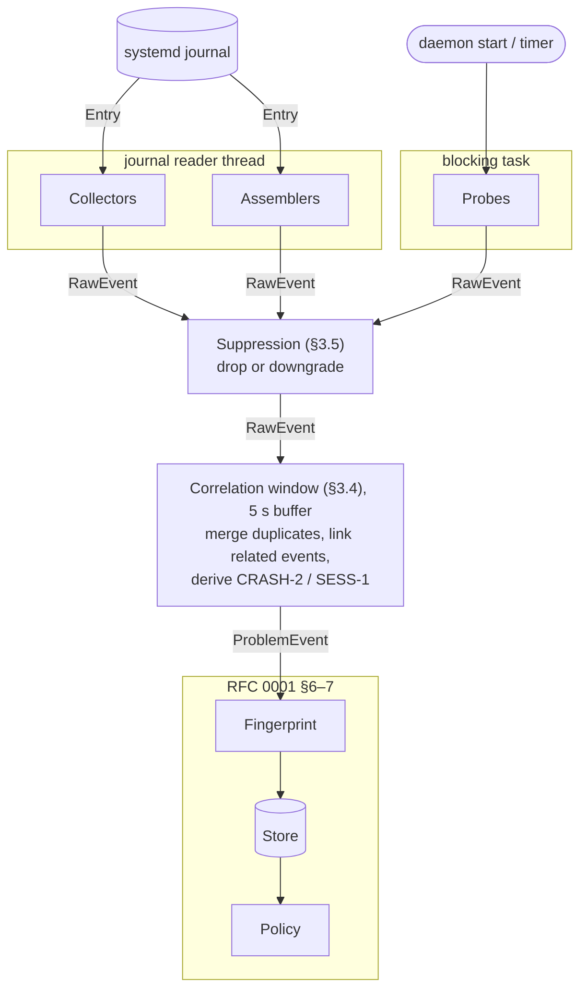

# RFC 0002: Detectors

| | |
|---|---|
| **Status** | Draft |
| **Created** | 2026-10-26 |
| **Depends on** | [RFC 0001: Daemon redesign](0001-daemon-redesign.md) (architecture, store, severity, policy, catalogue §5.5) |
| **Decisions** | [ADR 0003](../adr/0003-problem-visibility.md) (owner), [ADR 0005](../adr/0005-notification-threshold.md) (threshold), [ADR 0007](../adr/0007-report-structure.md) (kinds, `details`, micro journal scope, scrubbing), [ADR 0009](../adr/0009-store-viewer-data.md) (evidence cursors, excerpts), [ADR 0011](../adr/0011-detector-contract.md) (proposed: detector contract, to replace the four types of §3.1), [ADR 0012](../adr/0012-shadow-mode-rollout.md) (proposed: shadow-mode rollout), [ADR 0013](../adr/0013-problem-fingerprint.md) (proposed: fingerprint inputs, replacing the "Fingerprint" lines of §5). Where this RFC and an ADR differ, the ADR wins |
| **Affects** | `crates/collect` (new), `crates/daemon`, `module.nix` |

## 1. Summary

RFC 0001 §5.5 decided **what** Relago detects: the 18 problem types in the RFC 0001 catalogue (§5.5). This RFC specifies **how**:

- a common **detector framework**: four detector types, one event pipeline, correlation, suppression windows, self-protection, configuration, and two test benches;
- a **specification per detector**: source, matching, parsing, captured fields, fingerprint, severity rules, noise controls, micro-report fields, and prerequisites.

## 2. Conventions

- IDs (CRASH-1, SVC-2, …) are the catalogue IDs from RFC 0001 §5.5.
- **systemd message IDs** (§4.1) are verified against the systemd version in the pinned nixpkgs, with a link to each definition. §4.3 keeps them verified on every nixpkgs bump.
- **Kernel message formats in this document are unverified.** They come from kernel sources as remembered by the authors. No detector is merged until its constants pass the §4.3 check and it has real fixtures.
- "Kernel message" means a journal entry with `_TRANSPORT=kernel`. Its text is in `MESSAGE`.
- Severity names follow RFC 0001 §6.2: **C**ritical, **H**igh, **L**ow, **I**nfo. Only H and C notify by default (ADR 0005).
- Problem kinds are the 15 kinds of ADR 0007 §4. CRASH-2 has no kind of its own (it modifies CRASH-1, SVC-1 and SVC-2 problems); SVC-1/SVC-2 share `unit_failure`; MEM-1/MEM-2 share `oom_kill`.
- "Micro-report details" below lists the fields of the detector's `details` object (ADR 0007 §4). The micro report's `journal` lines are scoped per kind by ADR 0007 §5 and scrubbed by ADR 0007 §6; they are not part of `details`.
- Rollout (active/shadow) follows [ADR 0012](../adr/0012-shadow-mode-rollout.md). The default severities of HW-2 and PWR-1 below are **proposals**, listed as pending decisions in `docs/adr/README.md`.
- Times are defaults. Every threshold is configurable (§3.8).

## 3. Framework

### 3.1 Detector types

| Type | Input | Output | Used by |
|---|---|---|---|
| **Collector** | One journal `Entry` | 0..1 `RawEvent` | CRASH-1, SVC-1, SVC-2, MEM-1, MEM-2, DISK-3, NIX-1, NIX-2 |
| **Assembler** | A *sequence* of kernel entries (multi-line reports) | 0..1 `RawEvent` when the block is complete | KERN-2, HW-1, HW-2, DISK-1 |
| **Probe** | Filesystem / sysfs / previous boot's journal, run on start or on a timer | 0..n `RawEvent` | KERN-1, DISK-2, PWR-1, NIX-3 |
| **Correlator** | Other detectors' `RawEvent`s and the store | New or modified events | CRASH-2, SESS-1, plus cross-detector de-duplication (§3.4) |

```rust
pub trait Collector: Send + Sync {
    fn id(&self) -> DetectorId;                          // "CRASH-1", …
    fn matches(&self) -> &'static [Match];               // journal matches (OR-ed across detectors)
    fn parse(&self, e: &Entry, ctx: &Ctx) -> Option<RawEvent>;
}

pub trait Assembler: Send + Sync {
    fn id(&self) -> DetectorId;
    fn matches(&self) -> &'static [Match];
    /// Feed one entry; return a finished event when a block completes.
    fn feed(&mut self, e: &Entry, ctx: &Ctx) -> Option<RawEvent>;
    /// Called every second; closes blocks that timed out.
    fn tick(&mut self, now: Instant, ctx: &Ctx) -> Vec<RawEvent>;
}

pub trait Probe: Send + Sync {
    fn id(&self) -> DetectorId;
    fn schedule(&self) -> Schedule;                      // OnStartOncePerBoot | Every(Duration)
    fn run(&mut self, ctx: &Ctx) -> anyhow::Result<Vec<RawEvent>>;
}

pub trait Correlator: Send + Sync {
    fn id(&self) -> DetectorId;
    fn on_event(&mut self, ev: &RawEvent, ctx: &Ctx) -> Vec<Correlation>;
    fn tick(&mut self, now: Instant, ctx: &Ctx) -> Vec<Correlation>;
}
```

`Ctx` gives read-only access to: the clock (fakeable), boot ID and boot time, current suppression windows (§3.5), the store (read-only), sysfs/procfs roots (overridable in tests), and the detector's own config section.

### 3.2 Pipeline



- All detectors run on the **one** journal reader thread; parsing is cheap. Probes run on a separate blocking task.
- Every `RawEvent` stays in the **correlation window** for 5 s before it becomes a `ProblemEvent`. This costs a 5 s notification delay and removes most duplicate reports (§3.4).
- A panic inside a detector is caught (`catch_unwind`). That detector is disabled until restart and a `relago-internal` problem is recorded. One bad parser never stops the daemon.

### 3.3 `RawEvent`

```rust
pub struct RawEvent {
    pub detector: DetectorId,
    pub kind: ProblemKind,// ADR 0007 §4
    pub at: SystemTime,
    pub boot_id: BootId,
    pub owner: Owner, // User(uid) | System; drives routing (ADR 0003)
    pub subject: Subject, // Exe{path, package} | Unit{name, user: bool} | Device{..} | Mount{..} | Kernel | Generation{..}
    pub severity_hint: Severity, // detector's default; policy may change it
    pub dedup_key: String,       // identity of this *occurrence*, see §3.4
    pub fp_parts: Vec<String>,   // inputs to the fingerprint (RFC 0001 §6.1)
    pub details: Details,        // enum, one variant per ProblemKind, allow-listed fields only
    pub evidence: Vec<Cursor>,   // all journal cursors used; stored per occurrence for the app (ADR 0009) and the full report
}
```

`Details` variants hold **only** fields that may appear in a micro report, and serialise to the report's `details` object with the closed schema of ADR 0007 §4. There is no free-form map, so a detector cannot leak an unexpected field (RFC 0001 §13).

### 3.4 Correlation and de-duplication

One real incident often produces several signals. Rules, applied inside the 5 s window:

| Signals seen together | Result |
|---|---|
| CRASH-1 (coredump of process in unit U) + SVC-1/SVC-2 (`UNIT_RESULT=core-dump` for U) | Keep **CRASH-1**; attach the unit to it; drop the SVC event |
| MEM-2 unit-level message + MEM-2 kernel `oom-kill:` line for the same pid/unit | One **MEM-2** with fields from both |
| MEM-1 or MEM-2 for unit U + SVC-1/SVC-2 (`UNIT_RESULT=oom-kill` for U) | Keep the **MEM** event; drop the SVC event |
| CRASH-1 of a compositor/shell + logind session stop for the same uid (§5, SESS-1) | Emit **SESS-1**; CRASH-1 is kept as linked evidence, but not notified separately |
| HW-1 GPU hang + SESS-1 session crash | Keep both; SESS-1 links to HW-1 as probable cause |
| SVC-1 events while an activation (NIX-1) is running | Folded into **NIX-1** as its failed-unit list; not reported individually |
| DISK-1 I/O error + DISK-3 SMART failure on the same device | Keep both; link DISK-1 → DISK-3 |
| KERN-1 panic dump for previous boot + PWR-1 unclean shutdown for the same boot | Keep **KERN-1**; drop PWR-1. Correlated in the boot batch, not the 5 s window (§3.9) |

**Claims.** Some unit failures belong to a specialised detector instead of SVC-1. SVC-1 checks a fixed claim table of unit patterns before it emits an event. A matching failure is handed to the claiming detector, and SVC-1 emits nothing. Unlike the correlation rules above, a claim does not wait for the 5 s window, so the two detectors cannot race (RFC 0004 §12 K1).

| Unit pattern | Claimed by |
|---|---|
| `nixos-upgrade.service` | NIX-2 |

RFC 0004 §7 adds the units of the Nix detectors to this table. Under [ADR 0011](../adr/0011-detector-contract.md) (proposed), the table becomes claims declared by each detector.

**Occurrence de-duplication (`dedup_key`).** The journal can contain the same message twice (system and user journal files, or a re-read after a restart). Each detector defines a `dedup_key`, for example CRASH-1 uses `boot_id:COREDUMP_PID:COREDUMP_TIMESTAMP`. The store ignores an occurrence whose `dedup_key` it has already recorded for that problem.

### 3.5 Suppression windows

The daemon tracks system state from well-known journal messages and exposes it through `Ctx`:

| Window | Starts | Ends | Effect |
|---|---|---|---|
| **Boot** | Daemon start in a new boot | +120 s | Events recorded; notifications batched (RFC 0001 §6.3) |
| **Shutdown** | `shutdown.target` / `reboot.target` job start | End of boot | SVC-1/SVC-2 dropped (units fail while stopping); CRASH-1 kept |
| **Session start / stop** | logind session new / removed for uid | +30 s / until removed | SVC-2 for that uid downgraded to L |
| **Sleep** | `SD_MESSAGE_SLEEP_START` | `SD_MESSAGE_SLEEP_STOP` + 30 s | HW-1/DISK-1 from resume noise downgraded to L; SVC events kept |
| **Activation** | Start of `switch-to-configuration` (§5, NIX-1) | Its end + 10 s | SVC-1 folded into NIX-1 (§3.4) |

### 3.6 Self-protection

- **Own problems.** Crashes and failures of `relago` itself (exe or unit) never go through the normal flow; that would loop. They are recorded locally as `relago-internal` entries, visible in the Relago app and in detector stats. They are **not sent**: ADR 0007 defines no report kind for them. Sending them would need a new kind (ADR 0007 §7).
- **Floods.** Per detector: at most 50 `RawEvent`s/min. Above that, the detector switches to *counting only* for 10 min and records one "flood" event with the count. Globally, journal processing yields after 1 000 entries per batch, so a log storm cannot pin a CPU.
- **Memory.** Assembler buffers are capped (200 lines, 64 KiB per block). The correlation window is capped at 1 000 events; overflow flushes immediately without correlation.
- **Cursor.** After a restart, detectors resume from the persisted cursor (RFC 0001 §5.1). If the cursor is invalid (journal rotated or vacuumed), they resume from the tail and record a `relago-internal` "gap" event.

### 3.7 Shadow mode

Any detector can run in **shadow mode**: events are fully processed and stored with `state = shadow`, but never notified or sent. Counters are visible via `relago detectors stats` and the D-Bus `GetDetectorStats()` method.

w**Rollout ([ADR 0012](../adr/0012-shadow-mode-rollout.md)):** all new detectors ship in shadow mode for one release, except those with very low noise (CRASH-1, SVC-1, MEM-1, MEM-2, KERN-1). Promotion to active is a config default change, based on the collected counts. This addresses the tuning concern raised for HW-2 and PWR-1. Shadow-mode problems use `state = shadow` in the store (RFC 0001 §7.1).

### 3.8 Configuration

`config.toml`:

```toml
[detectors]
shadow_default = false          # true forces every detector into shadow mode

[detectors.DISK-2]
enable = true
shadow = false
severity = "high"               # override default
interval = "10m"
min_free_percent = 5
min_free_bytes = "2GiB"
boot_min_free_bytes = "50MiB"

[detectors.SVC-2]
ignore_units = ["org.gnome.SettingsDaemon.*.service"]   # glob, merged with built-in list
```

The NixOS module exposes `services.relago.detectors.<ID> = { enable; shadow; severity; settings = { … }; }`.

### 3.9 Detection across reboots

Some problems can only be detected after the machine has restarted. They describe the **previous boot**, and the daemon finds them when it starts, usually before anyone has logged in:

- KERN-1: a kernel panic, from the pstore dump saved during the crash,
- PWR-1: an unclean shutdown or failed resume, from the previous boot's journal,
- NIX-3: booting an older generation, from the system profiles,
- in RFC 0004: an interrupted switch (NIX-9c) and the end of a pending reboot (NIX-9).

The journal entries the daemon had not processed when the previous boot ended also belong here. After a restart the daemon resumes from its persisted cursor (§3.6), so the first entries it reads are the tail of the previous boot.

Six rules apply to all of them.

1. **Start order.** The daemon starts after `systemd-pstore.service`, so pstore records are already moved to `/var/lib/systemd/pstore` when KERN-1 runs. The NixOS module sets this ordering. Without it, a panic would only be found one boot later.

2. **Boot ledger.** On every start in a new boot, the daemon records the boot in `state.json`:

   ```jsonc
   "boots": [   // newest last, keeps the last 20
     { "boot_id": "…", "started_at": 1727700000000000, "kernel": "6.12.40",
       "system_hash": "b3…", "nixos_version": "25.11.20260901.abcdef0", "generation": 412 }
   ]
   ```

   A problem that describes an earlier boot takes its occurrence `boot_id` and `at` from that boot, and the report's `system` block is filled from that boot's ledger entry, not from the running system. After a panic the user often boots a different generation, so the running system would describe the wrong one. If the ledger has no entry for that boot (first run, or the daemon was not running), the kernel version comes from the previous boot's journal, and `nixos_version` and `system_hash` are left out.

3. **Boot batch.** All detectors scheduled once per boot run as one batch at start. Their outputs are correlated together when the whole batch has finished, instead of within the 5 s window of §3.4. Reading a previous boot's journal can take longer than 5 s, and without the batch a panic and its unclean shutdown would become two problems. A detector still running after 60 s is correlated on its own when it finishes. The rules that rely on the batch:
   - KERN-1 and PWR-1 for the same boot: keep KERN-1 (§3.4),
   - NIX-3 evidence: PWR-1, KERN-1, SESS-1 or NIX-1 recorded during a boot of the newest generation,
   - NIX-9c: PWR-1 for a boot that ended inside an Activation window (RFC 0004 §7).

4. **Delivery to a later session.** A notification counts as delivered only when an eligible session receives it: a graphical session of the owner for user problems, or of a `wheel` member for system problems (ADR 0003). Until then the problem stays *pending delivery*, and `last_notified` is not set. When the Relago app's background mode starts, it asks the daemon for problems pending delivery and shows them (the `pending_delivery` filter and `MarkDelivered`, RFC 0003 §5 and §7); several are combined into one "N problems detected since your last session" notification. The threshold and rate limits of RFC 0001 §6.3 still apply. SESS-1's "held until the next session" is this rule, not a special case.

5. **Pending checks across a reboot.** Pending records from an earlier boot, such as the 60 s recovery check of SVC-1 and SVC-2, are closed on start as **interrupted**. The failure is recorded with severity L and is not notified, because the reboot, not the service, ended the check. If that boot ended uncleanly (KERN-1 or PWR-1), the failure is linked to that problem as evidence.

6. **Windows per boot.** Suppression windows (§3.5) are tracked per boot ID. Replaying the previous boot's tail rebuilds its windows from its own entries, so a unit stopped during that boot's shutdown is still dropped by the Shutdown window. The Boot window of the current boot does not apply to these entries.

**Prerequisites.** KERN-1 needs a pstore backend (EFI variables or ramoops). PWR-1 and the journal fallback of rule 2 need persistent journal storage. On a machine without them, the detectors report "unsupported" in `relago detectors stats` and `GetDetectorStats()`, and the NixOS module prints a warning at build time. Xinux's defaults for both must be verified (§4.4).

### 3.10 Detector specification template

Each detector in §5 is described with these fields:

- **Type**: Collector / Assembler / Probe / Correlator.
- **Match**: journal matches or probe schedule.
- **Parse**: how an event is recognised and fields extracted; what is *rejected*.
- **Owner**: how the owning user (or System) is determined.
- **dedup_key / fingerprint**: occurrence identity, and inputs to the problem fingerprint.
- **Severity**: default and escalation rules.
- **Noise controls**: what prevents false or excessive reports.
- **Micro-report details**: the allow-listed fields in `Details`.
- **Prerequisites**: system configuration the detector needs, and what the NixOS module does about it.
- **Rollout**: active or shadow in the first release.

## 4. Journal constants

### 4.1 systemd message IDs

Verified against systemd **v260.1**, the version in the nixpkgs revision pinned by `flake.lock` ([`a799d3e`](https://github.com/NixOS/nixpkgs/blob/a799d3e3886da994fa307f817a6bc705ae538eeb/pkgs/os-specific/linux/systemd/default.nix)). Each constant links to its definition in [`sd-messages.h`](https://github.com/systemd/systemd/blob/v260.1/src/systemd/sd-messages.h) and to its entry in the [message catalog](https://github.com/systemd/systemd/blob/v260.1/catalog/systemd.catalog.in), which documents the message and its fields (`journalctl -x` shows the same text). The check in §4.3 keeps this table valid across nixpkgs bumps.

| Constant | ID | Catalog subject | Used by | Source |
|---|---|---|---|---|
| `SD_MESSAGE_COREDUMP` | `fc2e22bc6ee647b6b90729ab34a250b1` | Process … dumped core | CRASH-1 | [header](https://github.com/systemd/systemd/blob/v260.1/src/systemd/sd-messages.h#L41), [catalog](https://github.com/systemd/systemd/blob/v260.1/catalog/systemd.catalog.in#L66) |
| `SD_MESSAGE_UNIT_FAILURE_RESULT` | `d9b373ed55a64feb8242e02dbe79a49c` | Unit failed | SVC-1, SVC-2 | [header](https://github.com/systemd/systemd/blob/v260.1/src/systemd/sd-messages.h#L178), [catalog](https://github.com/systemd/systemd/blob/v260.1/catalog/systemd.catalog.in#L561) |
| `SD_MESSAGE_UNIT_FAILED` | `be02cf6855d2428ba40df7e9d022f03d` | A start job for unit … has failed | SVC-1, SVC-2 (fallback) | [header](https://github.com/systemd/systemd/blob/v260.1/src/systemd/sd-messages.h#L157), [catalog](https://github.com/systemd/systemd/blob/v260.1/catalog/systemd.catalog.in#L387) |
| `SD_MESSAGE_UNIT_STARTED` | `39f53479d3a045ac8e11786248231fbf` | A start job for unit … has finished successfully | SVC-1, SVC-2 (recovery) | [header](https://github.com/systemd/systemd/blob/v260.1/src/systemd/sd-messages.h#L155), [catalog](https://github.com/systemd/systemd/blob/v260.1/catalog/systemd.catalog.in#L378) |
| `SD_MESSAGE_UNIT_RESTART_SCHEDULED` | `5eb03494b6584870a536b337290809b3` | Automatic restarting of a unit has been scheduled | SVC-1, SVC-2, CRASH-2 | [header](https://github.com/systemd/systemd/blob/v260.1/src/systemd/sd-messages.h#L168), [catalog](https://github.com/systemd/systemd/blob/v260.1/catalog/systemd.catalog.in#L531) |
| `SD_MESSAGE_UNIT_PROCESS_EXIT` | `98e322203f7a4ed290d09fe03c09fe15` | Unit process exited | SVC-1, SVC-2 (exit code) | [header](https://github.com/systemd/systemd/blob/v260.1/src/systemd/sd-messages.h#L184), [catalog](https://github.com/systemd/systemd/blob/v260.1/catalog/systemd.catalog.in#L568) |
| `SD_MESSAGE_UNIT_OOMD_KILL` | `d989611b15e44c9dbf31e3c81256e4ed` | systemd-oomd killed one or more processes in unit … | MEM-1 | [header](https://github.com/systemd/systemd/blob/v260.1/src/systemd/sd-messages.h#L195), [catalog](https://github.com/systemd/systemd/blob/v260.1/catalog/systemd.catalog.in#L869) |
| `SD_MESSAGE_UNIT_OUT_OF_MEMORY` | `fe6faa94e7774663a0da52717891d8ef` | A process of … unit has been killed by the OOM killer | MEM-2 | [header](https://github.com/systemd/systemd/blob/v260.1/src/systemd/sd-messages.h#L198), [catalog](https://github.com/systemd/systemd/blob/v260.1/catalog/systemd.catalog.in#L604) |
| `SD_MESSAGE_SESSION_START` | `8d45620c1a4348dbb17410da57c60c66` | A new session … has been created for user … | SESS-1, §3.5 | [header](https://github.com/systemd/systemd/blob/v260.1/src/systemd/sd-messages.h#L48), [catalog](https://github.com/systemd/systemd/blob/v260.1/catalog/systemd.catalog.in#L88) |
| `SD_MESSAGE_SESSION_STOP` | `3354939424b4456d9802ca8333ed424a` | Session … has been terminated | SESS-1, §3.5 | [header](https://github.com/systemd/systemd/blob/v260.1/src/systemd/sd-messages.h#L50), [catalog](https://github.com/systemd/systemd/blob/v260.1/catalog/systemd.catalog.in#L98) |
| `SD_MESSAGE_SLEEP_START` | `6bbd95ee977941e497c48be27c254128` | System sleep state … entered | §3.5, PWR-1 | [header](https://github.com/systemd/systemd/blob/v260.1/src/systemd/sd-messages.h#L73), [catalog](https://github.com/systemd/systemd/blob/v260.1/catalog/systemd.catalog.in#L172) |
| `SD_MESSAGE_SLEEP_STOP` | `8811e6df2a8e40f58a94cea26f8ebf14` | System sleep state … left | §3.5, PWR-1 | [header](https://github.com/systemd/systemd/blob/v260.1/src/systemd/sd-messages.h#L75), [catalog](https://github.com/systemd/systemd/blob/v260.1/catalog/systemd.catalog.in#L179) |
| `SD_MESSAGE_SHUTDOWN` | `98268866d1d54a499c4e98921d93bc40` | System shutdown initiated | PWR-1, §3.5 | [header](https://github.com/systemd/systemd/blob/v260.1/src/systemd/sd-messages.h#L78), [catalog](https://github.com/systemd/systemd/blob/v260.1/catalog/systemd.catalog.in#L186) |

`SD_MESSAGE_UNIT_STARTED` and `SD_MESSAGE_UNIT_FAILED` are about **start jobs**, not unit state, despite their names ([header comment](https://github.com/systemd/systemd/blob/v260.1/src/systemd/sd-messages.h#L150-L152)). A unit that fails while running is reported only by `SD_MESSAGE_UNIT_FAILURE_RESULT`, which is why SVC-1/SVC-2 use that as the primary match.

> The current code filters OOM on `fe6bda9e7f4a4f5593682fcbcf9ee3f9` (`crates/daemon/src/crash.rs`). That ID does not exist in `sd-messages.h` v260.1; the kernel OOM ID is `fe6faa94e7774663a0da52717891d8ef`. This is one more reason for the check in §4.3.

### 4.2 Kernel message patterns

Kept in one module, `collect::kernel::patterns`, each with a unit test and at least one real sample. Listed per detector in §5.

### 4.3 Constant verification

A flake check (`checks.<system>.sd-message-ids`) reads `${pkgs.systemd.dev}/include/systemd/sd-messages.h`. It asserts that every constant in `collect::ids` exists there with the same value. A nixpkgs bump that changes an ID then fails CI instead of silently breaking detection.

### 4.4 Source references still needed

§4.1 links every systemd message ID to its definition at a pinned version. The identifiers below come from external sources too, but have no reference yet. Each needs a link to its source, pinned to the version in the nixpkgs revision Xinux uses, before its detector is merged.

| Identifier | Used in | Source to cite |
|---|---|---|
| nouveau FIFO fault messages (`nvkm`) | HW-1 | `drivers/gpu/drm/nouveau/nvkm/engine/fifo/` |
| `COREDUMP_*` fields (`COREDUMP_EXE`, `COREDUMP_OWNER_UID`, `COREDUMP_FILENAME`, …) | CRASH-1 | `systemd-coredump(8)` and `systemd.journal-fields(7)` |
| `UNIT_RESULT` values, `UNIT`, `USER_UNIT`, `_SYSTEMD_INVOCATION_ID`, `_UID`, `_TRANSPORT` | SVC-1, SVC-2, §2 | `systemd.journal-fields(7)`; the catalog entry of `SD_MESSAGE_UNIT_FAILURE_RESULT` |
| Kernel OOM lines (`oom-kill:constraint=…`, `Out of memory: Killed process …`) | MEM-2 | `mm/oom_kill.c` |
| Oops, BUG and WARNING headers, `---[ end trace … ]---` | KERN-2 | `kernel/panic.c`, `lib/bug.c`, arch fault handlers |
| `smartd` messages | DISK-3 | `smartd.cpp` in smartmontools |
| NVMe controller messages | DISK-3 | `drivers/nvme/host/core.c` |
| pstore paths and `dmesg-*` record names | KERN-1 | `systemd-pstore.service(8)` |
| `switch-to-configuration` messages, `nixos-rebuild-switch-to-configuration.service` | NIX-1 | `switch-to-configuration-ng` and `nixos-rebuild-ng` in nixpkgs |
| `systemd.coredump.enable` default; elfutils in `systemd-coredump` | CRASH-1 | the NixOS coredump module and the systemd package in nixpkgs |
| `systemd-pstore.service` and its ordering | KERN-1, §3.9 | `systemd-pstore.service(8)`; the NixOS systemd module |
| journald storage default on NixOS (`Storage=`) | PWR-1, §3.9 | `journald.conf(5)`; the NixOS journald module |

## 5. Detector specifications

### CRASH-1: Application / daemon crash (coredump)

- **Type:** Collector.
- **Match:** `MESSAGE_ID=SD_MESSAGE_COREDUMP`.
- **Parse:** requires `COREDUMP_EXE`, `COREDUMP_PID`, `COREDUMP_SIGNAL`. Optional: `COREDUMP_UID`, `COREDUMP_OWNER_UID`, `COREDUMP_UNIT`, `COREDUMP_USER_UNIT`, `COREDUMP_COMM`, `COREDUMP_TIMESTAMP`, `COREDUMP_FILENAME`, `COREDUMP_PACKAGE_NAME`/`_VERSION` (ELF package notes, rare on NixOS), and the stack trace embedded in `MESSAGE` (lines after "Stack trace of thread"). Rejects: exe is `relago` (§3.6); signal is `SIGQUIT`/`SIGABRT` **and** `COREDUMP_UNIT` is in shutdown (§3.5).
- **Package:** from `COREDUMP_EXE` if under `/nix/store/<32-char hash>-<name>-<version>/`. The name/version split uses the nixpkgs rule: the version starts at the first `-` followed by a digit. Otherwise from `COREDUMP_PACKAGE_*`, else none.
- **Owner:** `User(COREDUMP_OWNER_UID or COREDUMP_UID)` if uid ≥ 1000 and not a system user; else `System`.
- **dedup_key:** `boot_id:COREDUMP_PID:COREDUMP_TIMESTAMP`.
- **Fingerprint:** `CRASH-1 || package.name (or exe basename) || signal || top-5 frames` (function name, else `module+offset` rounded to the page, else nothing). Q6 decides frame depth and source.
- **Severity:** C if owner is a user; H if system; L if the process's unit restarted successfully within 60 s (via SVC-1 recovery tracking).
- **Noise controls:** CRASH-2 folds repetitions; fixed ignore list for known test binaries (`crash`, used in development) only in debug builds.
- **Micro-report details:** package name and version, exe basename, signal (name + number), frames, unit name, `COREDUMP_COMM`, whether a core file exists. **Not** cmdline args, environment, `COREDUMP_CWD`, or open files.
- **Prerequisites:** `systemd.coredump.enable = true` (NixOS default); stack traces need `systemd-coredump` built with elfutils (verify in nixpkgs).
- **Rollout:** active from its first release (very low noise; exception in [ADR 0012](../adr/0012-shadow-mode-rollout.md)).

### CRASH-2: Crash loop

- **Type:** Correlator over the store.
- **Rule:** the same CRASH-1 fingerprint ≥ 3 occurrences in 10 min, **or** SVC-1/SVC-2 with `UNIT_RESULT=start-limit-hit` (systemd gave up restarting).
- **Effect:** does not create a new problem. It raises the existing problem's severity by one level (L→H, H→C) and sets a `looping` flag. The notification text becomes "X keeps crashing (N times in 10 min)". Only one notification per loop episode; the episode ends after 30 min without occurrences.
- **Micro-report details:** none of its own. It sets `problem.occurrences.looping = true` in the micro report (ADR 0007 §2) of the affected problem.
- **Rollout:** **shadow** for its first release ([ADR 0012](../adr/0012-shadow-mode-rollout.md)), then promoted on its shadow counts.

### SVC-1: System service failed

- **Type:** Collector + recovery tracking.
- **Match:** `MESSAGE_ID=SD_MESSAGE_UNIT_FAILURE_RESULT` from PID 1 (`_PID=1`), plus `UNIT_STARTED` and `RESTART_SCHEDULED` for recovery.
- **Parse:** `UNIT`, `UNIT_RESULT` (`exit-code`, `signal`, `core-dump`, `timeout`, `watchdog`, `oom-kill`, `start-limit-hit`, `resources`, …), `_SYSTEMD_INVOCATION_ID`; exit code/status from the preceding `UNIT_PROCESS_EXIT` for the same invocation, if seen.
- **Recovery:** on failure, open a *pending* record keyed by unit. If `UNIT_STARTED` for that unit arrives within 60 s, severity is L (transient). Otherwise, after 60 s, severity is H. Pending records are persisted in `state.json` (RFC 0001 §7.1). A record from an earlier boot is closed as interrupted (§3.9).
- **Rejects:** during the Shutdown window; `UNIT_RESULT=core-dump` or `oom-kill` (handled by CRASH-1 or MEM-1/MEM-2 via §3.4); units on the ignore list; transient `run-*.scope`/`session-*.scope` units.
- **Owner:** `System` (notified to `wheel`, ADR 0003).
- **dedup_key:** `boot_id:UNIT:_SYSTEMD_INVOCATION_ID`.
- **Fingerprint:** `SVC-1 || unit name (instance part of templates stripped: foo@bar → foo@) || UNIT_RESULT || exit status`.
- **Micro-report details:** unit result, exit code/status, restart count, and whether it recovered (`details` of `unit_failure`, ADR 0007 §4); the unit name is in `subject`. The micro `journal` contains the lines of the failed invocation (`_SYSTEMD_INVOCATION_ID`), per ADR 0007 §5.
- **Built-in ignore list:** units whose failure is not a system bug: `systemd-networkd-wait-online.service`, `NetworkManager-wait-online.service`, `*.mount` for removable media, `systemd-fsck@dev-disk-by*` when the device is removable (verify each against real systems before shipping).
- **Rollout:** active from its first release (very low noise; exception in [ADR 0012](../adr/0012-shadow-mode-rollout.md)).

### SVC-2: User service failed

- **Type:** Collector; same logic as SVC-1.
- **Match:** the same message IDs, emitted by user managers (`_UID` ≠ 0, `USER_UNIT` present).
- **Parse:** `USER_UNIT` instead of `UNIT`; uid from `_UID`.
- **Owner:** `User(_UID)`.
- **Noise controls:** Session start/stop windows (§3.5) downgrade to L; built-in ignore list for units known to fail harmlessly in GNOME sessions (to be built from shadow-mode data).
- **Fingerprint:** `SVC-2 || user unit (instance stripped) || UNIT_RESULT || exit status`, without the uid.
- **Rollout:** **shadow** for its first release ([ADR 0012](../adr/0012-shadow-mode-rollout.md)), then promoted on its shadow counts (noise from GNOME user services unknown).

### SESS-1: Desktop session crashed

- **Type:** Correlator.
- **Inputs:** CRASH-1 events whose exe/package is a session-critical component (`gnome-shell`, `mutter`, `gnome-session-binary`, `Xwayland`, `kwin_wayland`, `plasmashell`; list configurable), and logind session stop/`SESSION_STOP` events.
- **Rule:** CRASH-1 for a critical component of uid U, followed within 15 s by the end of U's graphical session. Also triggered by `gnome-session` logging an unrecoverable failure (pattern to be collected).
- **Owner:** `User(U)`.
- **Timing:** the user sees it *after* logging back in. The notification is pending until a new session for U starts, then shown immediately (§3.9, rule 4); the boot-window batching does not apply.
- **Fingerprint:** `SESS-1 || component package || linked CRASH-1 fingerprint`.
- **Severity:** C.
- **Micro-report details:** component name and version, linked CRASH-1 details, session type (wayland/x11), desktop (`XDG_CURRENT_DESKTOP`), and linked HW-1 if a GPU hang happened in the preceding 30 s.
- **Rollout:** **shadow** for its first release ([ADR 0012](../adr/0012-shadow-mode-rollout.md)), then promoted on its shadow counts.

### MEM-1: systemd-oomd kill

- **Type:** Collector.
- **Match:** `MESSAGE_ID=SD_MESSAGE_UNIT_OOMD_KILL`.
- **Parse:** victim unit from `UNIT` / `USER_UNIT` (**not** `_PID`/`_COMM`, which describe systemd-oomd itself). Pressure/swap figures if present in fields.
- **App identification:** GNOME/KDE launch apps into scopes named `app-<launcher>-<app-id>-<rand>.scope`. Extract `<app-id>` (e.g. `org.mozilla.firefox`) and show that name.
- **Owner:** `User(uid)` for units under `user-<uid>.slice`, else `System`.
- **dedup_key:** `boot_id:unit:timestamp`.
- **Fingerprint:** `MEM-1 || app-id or unit (instance stripped)`.
- **Severity:** C for user apps, H for system units.
- **Micro-report details:** app id / unit, total RAM, total swap, whether zram is used, memory pressure at kill time if logged.
- **Rollout:** active from its first release (very low noise; exception in [ADR 0012](../adr/0012-shadow-mode-rollout.md)).

### MEM-2: Kernel OOM kill

- **Type:** Collector (two matches, merged via §3.4).
- **Match 1:** `MESSAGE_ID=SD_MESSAGE_UNIT_OUT_OF_MEMORY` ("a process of this unit was killed by the OOM killer"), with the unit in `UNIT` / `USER_UNIT`.
- **Match 2:** kernel message `oom-kill:constraint=<c>,…,task=<comm>,pid=<pid>,uid=<uid>` (a single-line summary, more stable than the multi-line dump). The `Out of memory: Killed process <pid> (<comm>) … anon-rss:<n>kB …` line supplies the RSS.
- **Owner:** from `uid` in match 2, or from the unit's slice.
- **dedup_key:** `boot_id:pid`.
- **Fingerprint:** `MEM-2 || comm or app-id || constraint`.
- **Severity:** C (user) / H (system).
- **Micro-report details:** comm/app id, constraint (`CONSTRAINT_NONE`, `CONSTRAINT_MEMCG`, …), anon-rss, total RAM/swap, whether systemd-oomd is enabled.
- **Rollout:** active from its first release (very low noise; exception in [ADR 0012](../adr/0012-shadow-mode-rollout.md)).

### KERN-1: Kernel panic in the previous boot

- **Type:** Probe, `OnStartOncePerBoot`, in the boot batch (§3.9).
- **Source:** `/var/lib/systemd/pstore/`, where `systemd-pstore.service` moves records from `/sys/fs/pstore` at boot. Each record is a set of `dmesg-*` files.
- **Parse:** records not yet seen (tracked in `state.json` by directory name). Reassemble the dmesg parts in order. Find the `Kernel panic - not syncing: <reason>` line, the `RIP:` function, the first call-trace frames, and the `Tainted:` flags.
- **Owner:** `System`.
- **dedup_key:** pstore record id.
- **Fingerprint:** `KERN-1 || panic reason (numbers stripped) || RIP function || top-5 call-trace functions`.
- **Severity:** C (notified to `wheel`).
- **Micro-report details:** panic reason, RIP function, call-trace function names, taint flags, kernel version **of the crashed boot** (from the dump), and module list only if tainted by an out-of-tree module (names only).
- **Prerequisites:** a pstore backend (EFI variables or ramoops) and `systemd-pstore.service` enabled. The module ensures the service is enabled, orders the daemon after it (§3.9), and grants `relago` read access (tmpfiles ACL). The detector reports "unsupported" in stats if no backend is present.
- **Rollout:** active from its first release (very low noise; exception in [ADR 0012](../adr/0012-shadow-mode-rollout.md)).

### KERN-2: Kernel oops / BUG / WARNING

- **Type:** Assembler.
- **Match:** `_TRANSPORT=kernel`.
- **Block start:** `^WARNING: CPU: \d+ PID: \d+ at (\S+):(\d+) (\S+)`, `^BUG: `, `^kernel BUG at (\S+):(\d+)`, `^Oops: `, `^general protection fault`, `^Unable to handle kernel`.
- **Block end:** `---[ end trace <hash> ]---`, or 2 s without a kernel message, or 200 lines.
- **Parse:** kind (warning/bug/oops/gpf), source `file:line` and function for WARN, `RIP:` function for oops/gpf, `Tainted:` flags, `Modules linked in:` (names only), and the first 5 call-trace functions (`? ` frames skipped).
- **Owner:** `System`.
- **dedup_key:** `boot_id:end-trace-hash`, or a hash of the header line.
- **Fingerprint:** `KERN-2 || kind || function || file:line (WARN only) || top-3 call-trace functions`, without addresses or offsets.
- **Severity:** H for oops/BUG/gpf; L for WARNING. WARNINGs are raised to H if the same fingerprint recurs in ≥ 3 boots.
- **Noise controls:** `WARN_ONCE` behaviour means one per boot per site. Warnings with taint `P`/`O` (proprietary/out-of-tree module) get a `third_party` flag so the server can route them.
- **Micro-report details:** the parsed fields above; **no** raw register dump.
- **Rollout:** **shadow** for its first release ([ADR 0012](../adr/0012-shadow-mode-rollout.md)), then promoted on its shadow counts (WARNING noise unknown); oops/BUG may be promoted earlier.

### HW-1: GPU hang / reset

Verified against Linux 6.18.34 and the NVIDIA open kernel modules 595.80 (the `production` driver in the pinned nixpkgs, [`nvidia-x11`](https://github.com/NixOS/nixpkgs/blob/a799d3e3886da994fa307f817a6bc705ae538eeb/pkgs/os-specific/linux/nvidia-x11/default.nix#L73-L74)). Message texts below are exact format strings from those sources; driver prefixes such as `i915 0000:00:02.0: [drm]` come from the kernel's device logging.

- **Type:** Assembler (short blocks; most signals are one or two lines).
- **Driver-independent signal.** In Linux 6.18 the DRM core reports a device that a driver could not recover, or recovered only by a reset, with [`drm_dev_wedged_event()`](https://git.kernel.org/pub/scm/linux/kernel/git/stable/linux.git/tree/drivers/gpu/drm/drm_drv.c?h=v6.18.34#n563). It logs [`device wedged, but recovered through reset`](https://git.kernel.org/pub/scm/linux/kernel/git/stable/linux.git/tree/drivers/gpu/drm/drm_drv.c?h=v6.18.34#n588) or `device wedged, needs recovery`, and sends a uevent with `WEDGED=<method>` and, when known, `PID=` and `TASK=` of the guilty process ([`drm-uapi.rst`, "Device Wedging"](https://git.kernel.org/pub/scm/linux/kernel/git/stable/linux.git/tree/Documentation/gpu/drm-uapi.rst?h=v6.18.34#n379)). i915, xe and amdgpu call it; nouveau and NVIDIA do not.
- **Patterns per driver:**

  | Driver | Hang | Reset result | Guilty process |
  |---|---|---|---|
  | i915 | [`GPU HANG: ecode %d:%x:%08x`](https://git.kernel.org/pub/scm/linux/kernel/git/stable/linux.git/tree/drivers/gpu/drm/i915/i915_gpu_error.c?h=v6.18.34#n2048), logged with [`drm_info`](https://git.kernel.org/pub/scm/linux/kernel/git/stable/linux.git/tree/drivers/gpu/drm/i915/i915_gpu_error.c?h=v6.18.34#n2243) | [`Resetting %s for %s`](https://git.kernel.org/pub/scm/linux/kernel/git/stable/linux.git/tree/drivers/gpu/drm/i915/gt/intel_reset.c?h=v6.18.34#n1346) (engine), [`Resetting chip for %s`](https://git.kernel.org/pub/scm/linux/kernel/git/stable/linux.git/tree/drivers/gpu/drm/i915/gt/intel_reset.c?h=v6.18.34#n1228); failure: [`Failed to reset chip`](https://git.kernel.org/pub/scm/linux/kernel/git/stable/linux.git/tree/drivers/gpu/drm/i915/gt/intel_reset.c?h=v6.18.34#n1245) and a [wedged event](https://git.kernel.org/pub/scm/linux/kernel/git/stable/linux.git/tree/drivers/gpu/drm/i915/gt/intel_reset.c?h=v6.18.34#n1448) | `, in %s [%d]` appended to the hang line |
  | xe | [`Timedout job: seqno=%u, … in %s [%d]`](https://git.kernel.org/pub/scm/linux/kernel/git/stable/linux.git/tree/drivers/gpu/drm/xe/xe_guc_submit.c?h=v6.18.34#n1370) | [`reset started`](https://git.kernel.org/pub/scm/linux/kernel/git/stable/linux.git/tree/drivers/gpu/drm/xe/xe_gt.c?h=v6.18.34#n870) / [`reset failed (%pe)`](https://git.kernel.org/pub/scm/linux/kernel/git/stable/linux.git/tree/drivers/gpu/drm/xe/xe_gt.c?h=v6.18.34#n919); [wedged event](https://git.kernel.org/pub/scm/linux/kernel/git/stable/linux.git/tree/drivers/gpu/drm/xe/xe_device.c?h=v6.18.34#n1279) when the device is declared wedged | `in %s [%d]` in the timeout line |
  | amdgpu | [`ring %s timeout, signaled seq=%u, emitted seq=%u`](https://git.kernel.org/pub/scm/linux/kernel/git/stable/linux.git/tree/drivers/gpu/drm/amd/amdgpu/amdgpu_job.c?h=v6.18.34#n122); [`ring %s timeout, but soft recovered`](https://git.kernel.org/pub/scm/linux/kernel/git/stable/linux.git/tree/drivers/gpu/drm/amd/amdgpu/amdgpu_job.c?h=v6.18.34#n117) | [`Ring %s reset succeeded`](https://git.kernel.org/pub/scm/linux/kernel/git/stable/linux.git/tree/drivers/gpu/drm/amd/amdgpu/amdgpu_job.c?h=v6.18.34#n141) / [`failed`](https://git.kernel.org/pub/scm/linux/kernel/git/stable/linux.git/tree/drivers/gpu/drm/amd/amdgpu/amdgpu_job.c?h=v6.18.34#n147); full reset [`GPU reset(%d) succeeded!`](https://git.kernel.org/pub/scm/linux/kernel/git/stable/linux.git/tree/drivers/gpu/drm/amd/amdgpu/amdgpu_device.c?h=v6.18.34#n6444) / [`GPU reset(%d) failed with error %d`](https://git.kernel.org/pub/scm/linux/kernel/git/stable/linux.git/tree/drivers/gpu/drm/amd/amdgpu/amdgpu_device.c?h=v6.18.34#n6433); [wedged event "recovered through reset"](https://git.kernel.org/pub/scm/linux/kernel/git/stable/linux.git/tree/drivers/gpu/drm/amd/amdgpu/amdgpu_device.c?h=v6.18.34#n6610) after success | [` Process %s pid %d thread %s pid %d`](https://git.kernel.org/pub/scm/linux/kernel/git/stable/linux.git/tree/drivers/gpu/drm/amd/amdgpu/amdgpu_vm.c?h=v6.18.34#n3204) after the timeout line |
  | nouveau | [`channel %d killed!`](https://git.kernel.org/pub/scm/linux/kernel/git/stable/linux.git/tree/drivers/gpu/drm/nouveau/nouveau_chan.c?h=v6.18.34#n57); the FIFO fault lines come from `nvkm` and are not verified yet | none logged | none |
  | NVIDIA (open and proprietary modules) | [`NVRM: Xid (PCI:%04x:%02x:%02x): %d, pid=%s, name=%s, %s`](https://github.com/NVIDIA/open-gpu-kernel-modules/blob/595.80/src/nvidia/src/kernel/gpu/rc/kernel_rc.c#L386-L395); without `pid=…, name=…` when unknown; on multi-instance GPUs the parenthesis also carries `GPU-I:`/`GPU-CI:` | from the Xid code ([NVIDIA Xid table](https://docs.nvidia.com/deploy/xid-errors/)) | `pid=`, `name=` |

  The older amdgpu line `GPU reset begin!` no longer exists in 6.18.
- **Parse:** driver, PCI address, engine/ring, Xid or ecode class, the offending process name if logged, and reset result.
- **Enrichment:** GPU vendor:device ID and driver version from sysfs (`/sys/bus/pci/devices/<addr>/{vendor,device}`, `/sys/module/<driver>/version` if present).
- **Owner:** `System`. The offending process name is kept in `details.comm`; its uid cannot be read reliably after the fact, so the problem is not routed to that user.
- **Fingerprint:** see [ADR 0013](../adr/0013-problem-fingerprint.md) §3 (`gpu_hang`).
- **Severity:** H; C if the reset failed (a driver failure line, or `device wedged, needs recovery`) or SESS-1 follows.
- **Situations:**
  - *One incident, several lines.* A hang, its reset and a wedged event are one occurrence. **Proposal:** a block is keyed by PCI address and closes 10 s after its last line.
  - *Reset result.* "Failed" is reliable across drivers: a driver failure line or `device wedged, needs recovery`. "Succeeded" is driver-specific: i915 and xe log no wedged event on success, amdgpu logs `device wedged, but recovered through reset`.
  - *No reset line at all* (nouveau, NVIDIA): the result is unknown, not "succeeded". For NVIDIA, which Xid codes mean "GPU lost" (C) is decided from NVIDIA's Xid table when the fixtures are recorded.
  - *Soft recovery* (amdgpu `but soft recovered`): recorded as L, not H; the GPU kept running.
- **Noise controls:** Sleep window (§3.5) downgrades resets within 30 s of resume. A reset storm (> 5 in 1 min) is one event with a count.
- **Micro-report details:** driver, GPU vendor/device ID, driver version, engine, Xid/ecode, reset result, offending process name (comm only), kernel version.
- **Rollout:** **shadow** for its first release ([ADR 0012](../adr/0012-shadow-mode-rollout.md)), then promoted on its shadow counts; xe, nouveau and NVIDIA stay in shadow until fixtures exist.

### HW-2: Hardware errors (MCE / PCIe AER / EDAC)

Verified against Linux 6.18.34. `[Hardware Error]: ` is the kernel's [`HW_ERR`](https://git.kernel.org/pub/scm/linux/kernel/git/stable/linux.git/tree/include/linux/printk.h?h=v6.18.34#n119) prefix; machine-check lines also carry [`mce: `](https://git.kernel.org/pub/scm/linux/kernel/git/stable/linux.git/tree/arch/x86/kernel/cpu/mce/internal.h?h=v6.18.34#n6), AER lines [`AER: `](https://git.kernel.org/pub/scm/linux/kernel/git/stable/linux.git/tree/drivers/pci/pcie/aer.c?h=v6.18.34#n15), EDAC lines [`EDAC MC%d: `](https://git.kernel.org/pub/scm/linux/kernel/git/stable/linux.git/tree/drivers/edac/edac_mc.h?h=v6.18.34#n51).

- **Type:** Assembler, plus a periodic counter probe (see *Situations*).
- **Patterns:**
  - MCE, every logged error: [`mce: [Hardware Error]: Machine check`](https://git.kernel.org/pub/scm/linux/kernel/git/stable/linux.git/tree/arch/x86/kernel/cpu/mce/core.c?h=v6.18.34#n368) (printed for each record added to the pool, [`mce_gen_pool_add`](https://git.kernel.org/pub/scm/linux/kernel/git/stable/linux.git/tree/arch/x86/kernel/cpu/mce/genpool.c?h=v6.18.34#n97); not rate-limited).
  - MCE detail, only when no other handler claimed the error: [`[Hardware Error]: CPU %d: Machine Check%s: %Lx Bank %d: %016Lx`](https://git.kernel.org/pub/scm/linux/kernel/git/stable/linux.git/tree/arch/x86/kernel/cpu/mce/core.c?h=v6.18.34#n204), where `%s` is ` Exception` for a machine-check exception; printed by [`mce_default_notifier`](https://git.kernel.org/pub/scm/linux/kernel/git/stable/linux.git/tree/arch/x86/kernel/cpu/mce/core.c?h=v6.18.34#n644) only if the record's handled flags ([`MCE_HANDLED_*`](https://git.kernel.org/pub/scm/linux/kernel/git/stable/linux.git/tree/arch/x86/include/asm/mce.h?h=v6.18.34#n145)) are empty.
  - MCE on AMD, decoded: [`Corrected error, no action required.`, `Deferred error, no action required.`, `Uncorrected, software containable error.`](https://git.kernel.org/pub/scm/linux/kernel/git/stable/linux.git/tree/drivers/edac/mce_amd.c?h=v6.18.34#n784)
  - AER (three lines per error): [`%s%s error message received from %04x:%02x:%02x.%d`](https://git.kernel.org/pub/scm/linux/kernel/git/stable/linux.git/tree/drivers/pci/pcie/aer.c?h=v6.18.34#n968) with severity [`Correctable`, `Uncorrectable (Non-Fatal)`, `Uncorrectable (Fatal)`](https://git.kernel.org/pub/scm/linux/kernel/git/stable/linux.git/tree/drivers/pci/pcie/aer.c?h=v6.18.34#n526) and an optional `Multiple ` prefix; then [`PCIe Bus Error: severity=%s, type=%s, (%s)`](https://git.kernel.org/pub/scm/linux/kernel/git/stable/linux.git/tree/drivers/pci/pcie/aer.c?h=v6.18.34#n1000) and [`  device [%04x:%04x] error status/mask=%08x/%08x`](https://git.kernel.org/pub/scm/linux/kernel/git/stable/linux.git/tree/drivers/pci/pcie/aer.c?h=v6.18.34#n1014).
  - EDAC: [`%d CE %s%son %s (… grain:%ld syndrome:0x%lx …)`](https://git.kernel.org/pub/scm/linux/kernel/git/stable/linux.git/tree/drivers/edac/edac_mc.c?h=v6.18.34#n950) and [`%d UE %s%son %s (…)`](https://git.kernel.org/pub/scm/linux/kernel/git/stable/linux.git/tree/drivers/edac/edac_mc.c?h=v6.18.34#n9926).
- **Classification:** *corrected* (AER `Correctable`, EDAC `CE`, MCE with the UC bit, [bit 61](https://git.kernel.org/pub/scm/linux/kernel/git/stable/linux.git/tree/arch/x86/include/asm/mce.h?h=v6.18.34#n37), clear in the status, AMD `Corrected`/`Deferred`) vs *uncorrected* (the rest).
- **Owner:** `System`.
- **Fingerprint:** see [ADR 0013](../adr/0013-problem-fingerprint.md) §3 (`hw_error`).
- **Severity:** uncorrected → C. Corrected → **L**, raised to H only if the rate exceeds 100/hour for the same source (a sign of degrading hardware).
- **Situations:**
  - *MCE without a detail line.* When an EDAC driver, the corrected-errors collector or mcelog claims an MCE, only `Machine check events logged` appears, possibly followed by an EDAC line. Without a detail or EDAC line the class is unknown: the occurrence is recorded as `class: unknown`, severity L, and counted.
  - *Fatal machine checks panic the machine* before the journal is written. HW-2 never sees them live; KERN-1 finds the panic dump after the reboot (§3.9). **Proposal:** a KERN-1 panic whose reason or messages show a machine check is linked to HW-2 as an uncorrected error; KERN-1 keeps the problem.
  - *AER log lines are rate-limited*: correctable and non-fatal errors print at most [10 per 5 s](https://git.kernel.org/pub/scm/linux/kernel/git/stable/linux.git/tree/include/linux/ratelimit_types.h?h=v6.18.34#n9) per device ([init](https://git.kernel.org/pub/scm/linux/kernel/git/stable/linux.git/tree/drivers/pci/pcie/aer.c?h=v6.18.34#n398)). Counting log lines undercounts. **Proposal:** the rate rule uses the kernel's exact counters instead, read every 10 min: [`aer_dev_correctable`, `aer_dev_nonfatal`, `aer_dev_fatal`](https://git.kernel.org/pub/scm/linux/kernel/git/stable/linux.git/tree/drivers/pci/pcie/aer.c?h=v6.18.34#n580) per PCI device ([ABI](https://git.kernel.org/pub/scm/linux/kernel/git/stable/linux.git/tree/Documentation/ABI/testing/sysfs-bus-pci-devices-aer?h=v6.18.34)), and EDAC [`ce_count`, `ue_count`](https://git.kernel.org/pub/scm/linux/kernel/git/stable/linux.git/tree/drivers/edac/edac_mc_sysfs.c?h=v6.18.34#n896) per memory controller. Log lines still trigger the event and give the details.
  - *No EDAC driver* (most desktops without ECC memory) means no memory-error source at all. The EDAC part reports "unsupported" in stats; absence of EDAC lines never means "healthy".
  - *Virtual machines* usually expose no MCE, AER or EDAC; the detector reports "unsupported".
  - *rasdaemon* ([NixOS module](https://github.com/NixOS/nixpkgs/blob/a799d3e3886da994fa307f817a6bc705ae538eeb/nixos/modules/services/hardware/rasdaemon.nix)) reads the same events from kernel tracepoints and keeps its own database. It stays an optional source, as in RFC 0001 §5.5; the journal and the counters are the primary sources.
- **Noise controls:** corrected errors are counted, not stored as individual occurrences (one occurrence per hour with a count).
- **Micro-report details:** source, class, bank/status (MCE), PCI vendor:device and error type (AER), CE/UE counts (EDAC), CPU model.
- **Rollout:** **shadow** for its first release ([ADR 0012](../adr/0012-shadow-mode-rollout.md)), then promoted on its shadow counts.

### DISK-1: Filesystem / I/O errors

Verified against Linux 6.18.34. Message texts below are exact format strings from the kernel.

- **Type:** Assembler (short blocks), plus a periodic counter probe (see *Situations*).
- **Patterns:**
  - ext4: [`EXT4-fs error (device %s): %s:%d: comm %s: %pV`](https://git.kernel.org/pub/scm/linux/kernel/git/stable/linux.git/tree/fs/ext4/super.c?h=v6.18.34#n823) and decoded [errors](https://git.kernel.org/pub/scm/linux/kernel/git/stable/linux.git/tree/fs/ext4/super.c?h=v6.18.34#n1025). Read-only: [`Remounting filesystem read-only`](https://git.kernel.org/pub/scm/linux/kernel/git/stable/linux.git/tree/fs/ext4/super.c?h=v6.18.34#n831), printed with the [`EXT4-fs (%s): `](https://git.kernel.org/pub/scm/linux/kernel/git/stable/linux.git/tree/fs/ext4/super.c?h=v6.18.34#n1003) prefix.
  - Btrfs: every message has the form [`BTRFS %s (device %s%s): %pV`](https://git.kernel.org/pub/scm/linux/kernel/git/stable/linux.git/tree/fs/btrfs/messages.c?h=v6.18.34#n282), with the level (`error`, `critical`, `warning`, `info`, …) first and, once the filesystem has an error, a [` state <flags>`](https://git.kernel.org/pub/scm/linux/kernel/git/stable/linux.git/tree/fs/btrfs/messages.c?h=v6.18.34#n9) suffix after the device name: `BTRFS error (device sda1 state EA): …`. Specific lines: [`BTRFS: error (device %s%s) in %s:%d: errno=%d %s`](https://git.kernel.org/pub/scm/linux/kernel/git/stable/linux.git/tree/fs/btrfs/messages.c?h=v6.18.34#n169), [`forced readonly`](https://git.kernel.org/pub/scm/linux/kernel/git/stable/linux.git/tree/fs/btrfs/messages.c?h=v6.18.34#n198), [`csum failed root %lld ino %llu off %llu … mirror %d`](https://git.kernel.org/pub/scm/linux/kernel/git/stable/linux.git/tree/fs/btrfs/inode.c?h=v6.18.34#n270) (warning level), and the cumulative device counters [`bdev %s errs: wr %u, rd %u, flush %u, corrupt %u, gen %u`](https://git.kernel.org/pub/scm/linux/kernel/git/stable/linux.git/tree/fs/btrfs/volumes.c?h=v6.18.34#n7947:~:text=%22chunk%20%25llu%20missing%20%25d%20devices%2C%20max%20tolerance%20is%20%25d%20for%20writable%20mount%22%2C).
  - XFS: prefix [`XFS (%s): `](hhttps://git.kernel.org/pub/scm/linux/kernel/git/stable/linux.git/tree/fs/xfs/xfs_message.c?h=v6.18.34#n20). Shutdown: [`%s (0x%x) detected at %pS (%s:%d).  Shutting down filesystem.`](https://git.kernel.org/pub/scm/linux/kernel/git/stable/linux.git/tree/fs/xfs/xfs_fsops.c?h=v6.18.34#n537:~:text=xfs%5Falert%5Ftag%28mp%2C%20tag%2C%20%22%25s%20%280x%25x%29%20detected%20at%20%25pS%20%28%25s%3A%25d%29%2E%20Shutting%20down%20filesystem%2E%22%2C%20why%2C%20flags%2C%20%5F%5Freturn%5Faddress%2C%20fname%2C%20lnnum%29%3B), where `%s` is one of `Log I/O Error`, `Corruption of in-memory data`, `Corruption of on-disk metadata`, `Block device removal`, `Metadata I/O Error` ([reasons](https://git.kernel.org/pub/scm/linux/kernel/git/stable/linux.git/tree/fs/xfs/xfs_fsops.c?h=v6.18.34#n563)). Corruption: [`Corruption detected. Unmount and run xfs_repair`](https://git.kernel.org/pub/scm/linux/kernel/git/stable/linux.git/tree/fs/xfs/xfs_error.c?h=v6.18.34#n252), [`Metadata corruption detected at %pS, %s block 0x%llx`](https://git.kernel.org/pub/scm/linux/kernel/git/stable/linux.git/tree/fs/xfs/xfs_error.c?h=v6.18.34#n270). I/O: [`metadata I/O error in "%pS" at daddr 0x%llx len %d error %d`](https://git.kernel.org/pub/scm/linux/kernel/git/stable/linux.git/tree/fs/xfs/xfs_buf.c?h=v6.18.34#n1414).
  - Block layer: [`%s error, dev %s, sector %llu op 0x%x:(%s) flags 0x%x phys_seg %u prio class %u`](https://git.kernel.org/pub/scm/linux/kernel/git/stable/linux.git/tree/block/blk-mq.c?h=v6.18.34#n965). The first `%s` is a status name, not always `I/O`: [`I/O`](https://git.kernel.org/pub/scm/linux/kernel/git/stable/linux.git/tree/block/blk-core.c?h=v6.18.34#n188), [`critical medium`](https://git.kernel.org/pub/scm/linux/kernel/git/stable/linux.git/tree/block/blk-core.c?h=v6.18.34#n165), [`timeout`](https://git.kernel.org/pub/scm/linux/kernel/git/stable/linux.git/tree/block/blk-core.c?h=v6.18.34#n160), [`device offline`](https://git.kernel.org/pub/scm/linux/kernel/git/stable/linux.git/tree/block/blk-core.c?h=v6.18.34#n171), [`recoverable transport`](https://git.kernel.org/pub/scm/linux/kernel/git/stable/linux.git/tree/block/blk-core.c?h=v6.18.34#n162), and others in the same table.
  - Buffer heads: [`Buffer I/O error on dev %pg, logical block %llu%s`](hhttps://git.kernel.org/pub/scm/linux/kernel/git/stable/linux.git/tree/fs/buffer.c?h=v6.18.34#n147).
- **Parse:** device, filesystem, error class (`io`, `medium`, `timeout`, `offline`, `metadata`, `csum`, `readonly`, `shutdown`), and the mount point via `/proc/self/mountinfo`, matched by the filesystem's [major:minor](https://git.kernel.org/pub/scm/linux/kernel/git/stable/linux.git/tree/fs/proc_namespace.c?h=v6.18.34#n162).
- **Rejects:** `loop*`, `sr*`, `ram*`, `zram*` devices. Devices with [`/sys/block/<dev>/removable`](https://git.kernel.org/pub/scm/linux/kernel/git/stable/linux.git/tree/block/genhd.c?h=v6.18.34#n1164) = 1 or on USB are downgraded to L.
- **Owner:** `System`.
- **Fingerprint:** see [ADR 0013](../adr/0013-problem-fingerprint.md) §3 (`fs_error`). The device name is excluded because it can change between boots.
- **Severity:** C for read-only remount or shutdown of `/`, `/nix`, `/home`; H for other errors; L for removable devices.
- **Situations:**
  - *ext4 behaviour depends on its [`errors=`](https://git.kernel.org/pub/scm/linux/kernel/git/stable/linux.git/tree/Documentation/admin-guide/ext4.rst?h=v6.18.34#n259) mount option.* `continue`: only the error line, the filesystem keeps running (H). `remount-ro`: the error line, then `Remounting filesystem read-only` (C for `/`, `/nix`, `/home`). `panic`: the machine [panics](https://git.kernel.org/pub/scm/linux/kernel/git/stable/linux.git/tree/fs/ext4/super.c?h=v6.18.34#n823) before the journal is written, so only KERN-1 sees it after the reboot (§3.9). **Proposal:** a KERN-1 panic with an ext4 reason is linked to DISK-1, as for machine checks in HW-2.
  - *ext4 repeats an error summary* while the superblock records errors: [`error count since last fsck: %u`](https://git.kernel.org/pub/scm/linux/kernel/git/stable/linux.git/tree/fs/ext4/super.c?h=v6.18.34#n4138), [`initial error at time …`](https://git.kernel.org/pub/scm/linux/kernel/git/stable/linux.git/tree/fs/ext4/super.c?h=v6.18.34#n4141) and [`last error at time …`](https://git.kernel.org/pub/scm/linux/kernel/git/stable/linux.git/tree/fs/ext4/super.c?h=v6.18.34#n4158), first [5 minutes after mount](https://git.kernel.org/pub/scm/linux/kernel/git/stable/linux.git/tree/fs/ext4/super.c?h=v6.18.34#n5647), then [once a day](https://git.kernel.org/pub/scm/linux/kernel/git/stable/linux.git/tree/fs/ext4/super.c?h=v6.18.34#n3686). These lines are not new errors. **Proposal:** they are used only to notice errors that happened while Relago was not running: if the count is higher than the last value Relago stored, one occurrence is recorded.
  - *Log lines are rate-limited and undercount.* Block and buffer lines use `printk_ratelimited` (at most 10 per 5 s); Btrfs messages are limited to [100 per 5 s per level](https://git.kernel.org/pub/scm/linux/kernel/git/stable/linux.git/tree/fs/btrfs/messages.c?h=v6.18.34#n202), and checksum warnings further; XFS metadata I/O errors are [rate-limited](https://git.kernel.org/pub/scm/linux/kernel/git/stable/linux.git/tree/fs/xfs/xfs_buf.c?h=v6.18.34#n1249). **Proposal:** the burst count and the rate come from the kernel's counters, read every 10 min: ext4 [`/sys/fs/ext4/<dev>/errors_count`](https://git.kernel.org/pub/scm/linux/kernel/git/stable/linux.git/tree/fs/ext4/sysfs.c?h=v6.18.34#n240) (and the `first_error_*` / `last_error_*` files), Btrfs [`/sys/fs/btrfs/<fsid>/devinfo/<devid>/error_stats`](https://git.kernel.org/pub/scm/linux/kernel/git/stable/linux.git/tree/fs/btrfs/sysfs.c?h=v6.18.34#n2114) (also logged as the cumulative `bdev … errs:` line), and SCSI/SATA [`/sys/block/<dev>/device/ioerr_cnt`](https://git.kernel.org/pub/scm/linux/kernel/git/stable/linux.git/tree/drivers/scsi/scsi_sysfs.c?h=v6.18.34#n977). Log lines still trigger the event and give the class.
  - *Block errors name the whole disk* (`sda`, `nvme0n1`), not the partition, while mountinfo lists the filesystem's own device. The mount is found through the disk's partitions (`/sys/block/<disk>/<part>/{start,size}` against the sector) or, for device-mapper (LUKS, LVM), through `/sys/block/dm-N/slaves`. If no mount matches, the mount class is `other`.
  - *An unplugged USB disk* produces `device offline` block errors and, for XFS, a `Block device removal` shutdown. On removable devices these are L.
  - *Device model and transport.* The model comes from `device/model` ([SCSI/SATA](https://git.kernel.org/pub/scm/linux/kernel/git/stable/linux.git/tree/drivers/scsi/scsi_sysfs.c?h=v6.18.34#n676), [NVMe](https://git.kernel.org/pub/scm/linux/kernel/git/stable/linux.git/tree/drivers/nvme/host/sysfs.c?h=v6.18.34#n372)). There is **no** `transport` file in sysfs: the transport (`sata`, `nvme`, `usb`, `mmc`) is derived from the resolved `/sys/block/<dev>` path.
  - *Privacy.* ext4 messages can contain inode numbers and file paths, Btrfs checksum warnings inode and root numbers, XFS messages disk addresses. None of this text is copied into an event; only the class, filesystem and mount class are kept.
- **Noise controls:** an I/O error burst (same device, 10 s) becomes one event with a count.
- **Micro-report details:** filesystem, error class, mount point class, device model and transport (see *Situations*), and linked DISK-3 status. **No** inode numbers or file names from the message.
- **Rollout:** **shadow** for its first release ([ADR 0012](../adr/0012-shadow-mode-rollout.md)), then promoted on its shadow counts.

### DISK-2: Low disk space

- **Type:** Probe, `Every(10 min)` and `OnStart`.
- **Checks:** `statvfs` on the mount points containing `/`, `/nix/store`, `/boot` (or ESP mount), `/home`, `/var` (each distinct filesystem once).
- **Thresholds (defaults):** H when free < 5 % **or** < 2 GiB; C when free < 1 % or < 500 MiB. For `/boot`: H when free < 50 MiB, **or** less than the size of the largest kernel+initrd pair currently in `/boot` (the next `nixos-rebuild` would then fail).
- **Hysteresis:** the problem is marked `resolved` when free space goes back above threshold + 2 % (or + 1 GiB). It re-triggers only after being resolved.
- **Owner:** `System` (notified to `wheel`), including for `/home`.
- **Fingerprint:** `DISK-2 || mount point class`.
- **Micro-report details:** mount point class, filesystem type, total size bucket (e.g. "100–250 GiB"), free percentage, and for `/nix/store` the number of system generations and whether `nix.gc.automatic` is enabled (read from the generated config, if available).
- **Notification text** includes a concrete fix: `nix-collect-garbage -d`, or `boot.loader.systemd-boot.configurationLimit` for `/boot`.
- **Rollout:** **shadow** for its first release ([ADR 0012](../adr/0012-shadow-mode-rollout.md)), then promoted on its shadow counts.

### PWR-1: Unclean shutdown

- **Type:** Probe, `OnStartOncePerBoot`, in the boot batch (§3.9).
- **Method:** open the journal for the **previous boot** (`-b -1`). It was unclean if none of these appear in it: `SD_MESSAGE_SHUTDOWN`, or journald's final "Journal stopped" message. If the last entries of that boot are a `SLEEP_START` without a matching `SLEEP_STOP`, classify it as **failed resume** (the data for PWR-2 later).
- **Rejects:** a KERN-1 panic dump exists for that boot (§3.4); the previous boot is shorter than 60 s (boot loop, reported separately in the future); journal storage is volatile (no previous boot available, reported as "unsupported" in stats).
- **Owner:** `System`.
- **Fingerprint:** `PWR-1 || class (hard-reset | failed-resume)`.
- **Severity:** **L** (proposed; pending decision); raised to H if ≥ 3 unclean shutdowns occur in 7 days.
- **Micro-report details:** class, uptime of the previous boot, whether it ended during sleep, and the last kernel message classes before the end (e.g. "GPU hang", "I/O error"), not the messages themselves.
- **Rollout:** **shadow** for its first release ([ADR 0012](../adr/0012-shadow-mode-rollout.md)), then promoted on its shadow counts.

### DISK-3: Disk health (SMART / NVMe)

- **Type:** Collector.
- **Match:** `SYSLOG_IDENTIFIER=smartd`; kernel `nvme nvme\d+: .*(timeout|controller is down|Removing after probe failure)`.
- **Patterns (smartd):** `Device: (\S+) .*, FAILED SMART self-check`, `Device: (\S+) .*, (\d+) Currently unreadable \(pending\) sectors`, `Device: (\S+) .*, (\d+) Offline uncorrectable sectors`, `Device: (\S+) .*, SMART (Prefailure|Usage) Attribute: (\d+) (\S+) changed from (\d+) to (\d+)`, NVMe `Critical Warning`.
- **Classification:** failed self-check / critical warning → C; pending or uncorrectable sector count *increasing* → H; attribute value changes → I (recorded only).
- **Owner:** `System`.
- **Fingerprint:** `DISK-3 || class || device model` (model from smartd message or sysfs, not the device node).
- **Micro-report details:** class, device model, firmware version, transport, the attribute id/name and old/new values.
- **Prerequisites:** `services.smartd.enable`. The Relago module does **not** enable it silently; it offers `services.relago.detectors.DISK-3.enableSmartd` (default true on Xinux, set in the Xinux profile, not the module).
- **Rollout:** **shadow** for its first release ([ADR 0012](../adr/0012-shadow-mode-rollout.md)), then promoted on its shadow counts.

### NIX-1: System activation failed

- **Type:** Collector + Correlator (it opens the Activation window, §3.5).
- **Detection:** (verify per NixOS version)
  - Newer `nixos-rebuild-ng` runs activation in a transient unit, `nixos-rebuild-switch-to-configuration.service`. Its start opens the window; its result closes it (SVC-1 on this unit → NIX-1).
  - Messages from `switch-to-configuration`: `the following new units were started`, **`the following units failed: (.*)`**, `warning: error(s) occurred while switching to the new configuration`.
  - Activation script failures: `Activation script snippet '(\S+)' failed`.
  - At boot, stage-2 activation messages with the same patterns.
- **Parse:** failed unit list (also collected from SVC-1 events in the window), failed activation snippets, target generation (from `/run/current-system` after the window closes), and whether it was a boot-time or live activation.
- **Owner:** `System` (notified to `wheel`).
- **Fingerprint:** `NIX-1 || sorted failed unit names (instances stripped) || failed snippets`.
- **Severity:** H; C if `/run/current-system` did not change (switch aborted) **and** units failed.
- **Micro-report details:** failed units and their `UNIT_RESULT`, failed snippet names, NixOS version of the old and new generation, and SVC-1 details of each failed unit (capped at 5).
- **Rollout:** **shadow** for its first release ([ADR 0012](../adr/0012-shadow-mode-rollout.md)), then promoted on its shadow counts.

### NIX-2: Automatic upgrade failed

- **Type:** Collector (a specialisation of SVC-1).
- **Match:** a failure of `nixos-upgrade.service`, claimed from SVC-1 through the claim table (§3.4, Claims).
- **Parse:** the journal of that invocation, looking for the **first** `^error: ` line from Nix. Classify: `build-failure` (`builder for '…' failed`), `download` (`unable to download`, HTTP errors), `hash-mismatch`, `no-space` (`No space left on device`, links to DISK-2), `eval` (evaluation errors), `activation` (links to NIX-1), `other`.
- **Owner:** `System`.
- **Fingerprint:** `NIX-2 || class || derivation name without hash and version (build-failure only)`.
- **Severity:** H. After 3 consecutive failures, C (the system has stopped receiving updates).
- **Micro-report details:** class, derivation name (build failures), the flake input / channel name being upgraded to, consecutive failure count, and the first error line, scrubbed per ADR 0007 §6.
- **Rollout:** **shadow** for its first release ([ADR 0012](../adr/0012-shadow-mode-rollout.md)), then promoted on its shadow counts.

### NIX-3: Booted an older generation

- **Type:** Probe, `OnStartOncePerBoot`, in the boot batch (§3.9).
- **Method:** resolve `/run/booted-system` and the list of `/nix/var/nix/profiles/system-<N>-link` generations. Consider only generations **created before this boot's start time**, so a generation built after booting (e.g. `nixos-rebuild switch` then a daemon restart) does not count. If the booted system is not the newest of those, the user booted an older generation.
- **Parse:** booted generation number, newest generation number, NixOS versions of both (`nixos-version` in each).
- **Owner:** `System`.
- **Fingerprint:** `NIX-3 || newest generation's NixOS version` (one problem per "bad" generation).
- **Severity:** L by default (it also fires on deliberate rollbacks). Raised to H if there is evidence that the newest generation was bad: a PWR-1/KERN-1/SESS-1/NIX-1 event recorded during a boot of the newest generation.
- **Micro-report details:** generation numbers, both NixOS versions, the evidence kinds found, and the number of boots into the newest generation.
- **Rollout:** **shadow** for its first release ([ADR 0012](../adr/0012-shadow-mode-rollout.md)), then promoted on its shadow counts. Its Low problems would not notify anyway (ADR 0005).

## 6. Testing

### 6.1 Fixtures

```
crates/collect/tests/fixtures/
  CRASH-1/
    firefox-segv.export          # journalctl -o export
    firefox-segv.expected.json   # expected RawEvent(s)
    relago-self-crash.export     # must produce no event
  SVC-1/
    started-unit.export          # "Started foo.service" -> no event (the current code misreads it as a failure)
    …
  KERN-2/
    6.6-warn-i915.export
    6.12-oops-null-deref.export
  DISK-2/
    statvfs-cases.toml           # probe inputs as data, not live filesystems
```

- Every detector has **at least one positive and two negative** fixtures before merge.
- Kernel-text detectors (KERN-2, HW-1, HW-2, DISK-1) need samples from **at least two kernel major versions**.
- Fixture sources: team machines, the `crash` test project, VM tests (`echo c > /proc/sysrq-trigger` for KERN-1/PWR-1, `dmsetup error` targets for DISK-1, `stress-ng` for MEM-1/MEM-2), and public bug trackers (samples must be anonymised).
- Fixtures are anonymised with a small tool, `relago-fixture-scrub`, that rewrites hostnames, usernames, machine IDs and boot IDs consistently.

### 6.2 Test benches

Two test-only benches run detectors against recorded inputs, with a fake clock and a fake sysfs root, and compare the results to the `.expected.json` snapshot (via `insta`):

- **`DetectorBench`** runs **one** detector. It feeds an `.export` file to that detector and checks its own output. Every detector's positive and negative fixtures (§6.1) run here.
- **`PipelineBench`** runs **several** detectors through the full pipeline (§3.2) and checks the resulting `ProblemEvent`s. Correlation rules (§3.4), claims (§3.4) and suppression windows (§3.5) are tested here, with multi-detector fixtures.

### 6.3 VM tests (NixOS)

VM tests run every detector active (`shadow = false`), so they test detection and notification regardless of rollout.

| Test | Triggers | Asserts |
|---|---|---|
| `crash-loop` | Segfault a test binary 5× | 1 problem, count 5, CRASH-2 looping, 1 notification |
| `service-fail` | Unit with `ExecStart=false`, and one that fails then recovers | H for the first, L for the second |
| `oom` | `stress-ng --vm` in a memory-limited scope | MEM-2 with correct victim (not oomd/systemd) |
| `panic` | `echo c > /proc/sysrq-trigger` with ramoops configured, reboot | KERN-1 on next boot, no PWR-1; `system` block matches the crashed boot |
| `hard-reset` | VM reset without shutdown | PWR-1 (shadow) |
| `notify-after-login` | Panic, reboot, no login for 5 min, then log in as a `wheel` user | No notification before login; exactly one after |
| `pending-across-reboot` | Unit fails, reboot within 60 s | SVC-1 recorded as interrupted, severity L, linked to the unclean shutdown if there was one |
| `disk-full` | Fill a small `/boot` image | DISK-2 H, resolves after cleanup |
| `activation` | Switch to a config with a failing unit | One NIX-1 with the unit listed, no separate SVC-1 |

## 7. Open points

| # | Point | Proposal |
|---|---|---|
| 1 | Where do shadow-mode stats go to decide promotion? | Add an optional `client.detector_stats` field (counts only, no content) to `relago.micro/1`. ADR 0007 §7 allows adding optional fields; the schema change must be made first. Sent only if the user opted in (ADR 0004) |
| 2 | Allow third-party detectors (plugins)? | No for now; the traits stay internal. Revisit after the first release |
| 3 | Session-critical component list for SESS-1 on non-GNOME desktops | Ship the GNOME list; KDE/others via config |
| 4 | SVC-1 ignore list contents | Build from shadow data of SVC-2 and early SVC-1 users; ship a minimal list first |
| 5 | Stack source for CRASH-1/KERN-1 fingerprints | Depends on RFC 0001 Q6 |
| 6 | `system` block of problems from an earlier boot (§3.9, rule 2) | ADR 0007 §2 does not say which boot `system` describes. Record that it describes the boot in which the problem occurred, in an amendment to ADR 0007 |
