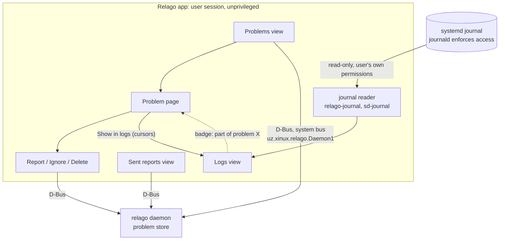

# RFC 0003: Relago app: problem and log viewer

| | |
|---|---|
| **Status** | Draft |
| **Created** | 2026-10-30 |
| **Depends on** | [RFC 0001](0001-daemon-redesign.md), [RFC 0002](0002-detectors.md) |
| **Decisions** | [ADR 0008](../adr/0008-single-relago-app.md) (one app, scope), [ADR 0009](../adr/0009-store-viewer-data.md) (store data for the viewer); also bound by [ADR 0003](../adr/0003-problem-visibility.md) (visibility), [ADR 0004](../adr/0004-opt-in-automatic-micro-reports.md) (consent), [ADR 0005](../adr/0005-notification-threshold.md) (threshold), [ADR 0006](../adr/0006-data-formats.md) (formats), [ADR 0007](../adr/0007-report-structure.md) (reports). Where this RFC and an ADR differ, the ADR wins |
| **Affects** | `crates/gui` → `crates/app`, new `crates/journal`, `relago-proto` D-Bus API, problem store layout, `module.nix` |

## 1. Summary

A desktop application, **Relago** (`uz.xinux.relago.Relago`), in the spirit of GNOME Logs. It lets users:

- browse the **problems** Relago detected: crashes, failures, kernel/hardware/storage/NixOS problems, with occurrences, severity and status;
- browse the **system logs** (the systemd journal): filter, search and follow them like GNOME Logs;
- move between the two: from a problem to the exact log entries it came from, and from a log entry to the problem it belongs to;
- see **what Relago sent** about them, and report, ignore or delete problems.

The app replaces the current reporter window. "Report…" in a notification opens the problem's page in this app (ADR 0008).

## 2. Goals and non-goals

**Goals**
- A GNOME Logs–level journal browser that stays fast on journals with millions of entries.
- Every problem links to its log evidence, even after journald has rotated the original entries.
- Full transparency: every report sent from this machine can be inspected.
- The daemon design (RFC 0001/0002) gains a stable, versioned D-Bus API that any client can use, not just this app.
- No privilege escalation in the app: it sees exactly what the user may see.

**Non-goals**
- Remote log collection or viewing other machines' logs.
- Editing or deleting journal entries (journald owns them).
- Browsing another user's problems (ADR 0003 stays in force).
- Non-journal log files (`/var/log/*.log`); may come later.
- Installing fixes or configuration patches from Xinux support. The Xinux system update mechanism does that; the app only shows a problem's resolution status (RFC 0001 §3, §9.2).

## 3. Architecture

Two data paths, deliberately separate:

| Data | Path | Why |
|---|---|---|
| Problems, occurrences, excerpts, sent reports, consent, ignores | **D-Bus → daemon** | The store is private to `relago` (mode `0700`, ADR 0002). The daemon enforces visibility (ADR 0003). The app never reads store files directly |
| Raw journal | **App reads the journal directly** via `sd-journal`, as the user | journald already enforces who may read what: own user journal for everyone, the system journal for `wheel`/`systemd-journal`. Routing logs through the daemon would duplicate journald and be slow |

### 3.1 Crates

| Crate | Change |
|---|---|
| `relago-journal` (new) | Shared journal code: `Entry` type, reader helpers (seek by cursor/time/boot, filters, paging), the ADR 0007 §6 scrubber, NDJSON export (`relago.journal/1`). Used by `collect`, `report`, and `app` |
| `relago-collect` | Depends on `relago-journal` for `Entry`, instead of defining it |
| `relago-proto` | D-Bus API v1 (§5): types, interface, proxy |
| `relago-app` (was `gui`) | The GTK4 / libadwaita / relm4 app. Depends on `proto` and `journal` only; no `report`, `reqwest`, or `pgp` |

## 4. User interface

A libadwaita app: `AdwNavigationSplitView` with a sidebar containing **Problems**, **Logs**, **Sent reports**, and **Settings**. It adapts to narrow widths.

### 4.1 Problems view

- **List** grouped by state: *Needs attention* (new, notified), *Reported*, *Ignored*, *Known*, *Resolved* (problems that cleared, such as low disk space after a cleanup). Problems from detectors in shadow mode ([ADR 0012](../adr/0012-shadow-mode-rollout.md)) are hidden by default; choosing the `shadow` state in the filters shows them, labelled "detector in testing". Each row shows the icon of the kind, title (e.g. "Firefox crashed", "Low disk space on /boot"), severity badge, occurrence count, last seen, and owner (system problems are marked for admins).
- **Filters:** kind, severity, state, time range, text search (over title, package, unit).
- **Problem page:**
  - *Summary*: plain-language explanation per kind, with a suggested fix where one exists (DISK-2: `nix-collect-garbage`; NIX-2: link to upgrade logs).
  - *Resolution*: shown when the server has provided one (RFC 0001 §9.2). Examples: "Xinux support prepared a fix; it will arrive through System Updates", "Fixed in an update", "Not a bug", "Support needs more information" (which offers "Send full report"). This is information only; there is no install action in the app.
  - *Occurrences*: timeline (count per day) and a list of occurrences (time, version, boot).
  - *Logs*: the stored excerpt of the selected occurrence, if one is kept. Excerpts exist for the first and the 3 most recent occurrences (ADR 0009). **"Show in logs"** opens the Logs view positioned at the evidence cursor. If journald has rotated those entries, the excerpt is shown with a banner "Original log entries are no longer available". If there is no excerpt either, the page says so.
  - *Details*: the problem's `details` (ADR 0007 §4) rendered as a property list.
  - *Reports*: reports sent for this problem, each openable (§4.3).
  - *Actions*: **Report…** (micro, with preview), **Send full report** (offered when the server asked for it, and available to the user on request; always with per-category consent, ADR 0004 and ADR 0007 §3.1), **Ignore** (user scope; system scope for admins via polkit), **Delete**.
- Notifications' "Report…" action opens the app directly on this page.

### 4.2 Logs view (GNOME Logs–style)

- **Boot selector:** current boot and previous boots (with start time and NixOS generation, if known).
- **Quick filters:** Important (priority ≤ warning), All, Applications, System, Kernel, Security (auth facilities); plus priority, unit, syslog identifier, time range, and free-text search.
- **List:** timestamp, priority icon, source (unit or identifier), and first line of the message. Rows that are evidence of a Relago problem show a badge; clicking it opens the problem.
- **Entry detail:** all fields of the entry, with a copy button and a "Show problem" link where applicable.
- **Follow mode:** new entries appear live at the bottom while enabled.
- **Export:** the current selection or filter to NDJSON (`relago.journal/1`, ADR 0006) or plain text. The **"Remove personal data"** option applies the ADR 0007 §6 scrubber and is on by default.
- **Permissions:** when the user cannot read the system journal, the view shows an explanation ("Only your own logs are shown; system logs require administrator access") instead of an empty list. The app does not escalate.

### 4.3 Sent reports view

- A list of every report sent from this machine for this user's problems (and system problems for admins): time, tier (micro/full), problem, server status (`new`/`known`), and send mode (auto/manual).
- Opening a micro report shows the exact JSON that was sent. Opening a full report shows its manifest: file list, sizes, consented categories. The archive itself is not kept (ADR 0009).

### 4.4 Settings

- Consent (ADR 0004), with an example micro report.
- Notification preferences: a per-user threshold. A user can only make it stricter than the system default of ADR 0005.
- Ignore list management.
- "Clear my problem history" (RFC 0001 Q8).

## 5. D-Bus API v1 (`uz.xinux.relago.Daemon1`)

This replaces the table in RFC 0001 §9.1. Because the app and future clients all use it, it is a **public, versioned contract**:
- `Version` is `1`.
- Additions are allowed within v1 and are advertised in `Capabilities`.
- Incompatible changes require `uz.xinux.relago.Daemon2`.
- The API ships in two steps (RFC 0001 §11). Phase 2 provides the properties, the **Problems** methods and the problem signals, advertised as capability `problems`; it needs only uid filtering, no polkit. Phase 4 adds **Reporting**, **Preferences** and the job signals, advertised as capability `reporting`. `Delete` and `ClearHistory` for system scope arrive with polkit in Phase 4.

**Common rules**
- **Problem ID:** the fingerprint string (`fp_v1:…`). It is stable across daemon restarts.
- **Visibility:** callers are identified by uid (`GetConnectionUnixUser`) and all results are filtered per ADR 0003.
- **Encoding:** list results are paged (`offset`, `limit` ≤ 200) and return `total`. Complex values are `a{sv}` dictionaries, so fields can be added without breaking clients.
- **Timestamps:** µs since epoch (`x`).

| Member | Signature | Notes |
|---|---|---|
| **Properties** | | |
| `Version` | `u` | `1` |
| `Capabilities` | `as` | e.g. `problems`, `reporting`, `excerpts`, `sent-reports`, `full-reports`, `detector-stats` |
| **Problems** | | |
| `ListProblems(filter a{sv}, offset u, limit u)` | → `(u total, aa{sv} problems)` | filter keys: `kinds as`, `min_severity s`, `states as`, `since x`, `until x`, `text s`, `owner s` (`me`/`system`), `pending_delivery b` (problems not yet delivered to an eligible session, RFC 0002 §3.9) |
| `GetProblem(id s)` | → `a{sv}` | includes `details` as a JSON string (ADR 0007 §4) and `resolution` (`a{sv}`, empty if none; RFC 0001 §9.2) |
| `MarkDelivered(id s)` | → | the caller's session has shown the notification; sets `last_notified` (RFC 0001 §6.3) |
| `ListOccurrences(id s, offset u, limit u)` | → `(u, aa{sv})` | each has `at`, `boot_id`, `version`, `cursors as`, `has_excerpt b` |
| `GetExcerpt(id s, occurrence u)` | → `s` | scrubbed journal excerpt, JSON (`relago.journal/1` lines as an array; bounded, so JSON per ADR 0006). Error `NoExcerpt` if none is kept (ADR 0009) |
| `ListEvidence(boot_id s)` | → `a(ss)` | `(cursor, problem id)` pairs for one boot, visible to the caller. The Logs view uses it to draw badges without one call per row |
| `Delete(id s)` | → | own problems; system problems need polkit |
| `ClearHistory(scope s)` | → `u` removed | `me` / `system` (polkit) |
| **Reporting** | | |
| `GetReportPreview(id s, full b)` | → `s` | exact JSON to be sent (micro report, or full-report manifest + micro), after scrubbing (ADR 0007 §6) |
| `Submit(id s, context s, full b, categories as)` | → `s` job id | `categories` for full reports; a full report records `requested_by` = `server` if the server asked for it, else `user` (ADR 0007 §3.1) |
| `ListSentReports(filter a{sv}, offset u, limit u)` | → `(u, aa{sv})` | `report_id`, `problem`, `tier`, `sent_at`, `server_status`, `send_mode` |
| `GetSentReport(report_id s)` | → `s` | micro JSON, or full report manifest |
| **Preferences** | | |
| `GetConsent()` / `SetConsent(micro_auto b)` | | ADR 0004 |
| `ListIgnores()` / `Ignore(pattern s, scope s)` / `Unignore(pattern s, scope s)` | | system scope needs polkit |
| `Register()` | | polkit, admin |
| `GetDetectorStats()` | → `aa{sv}` | admin only (RFC 0002 §3.7) |
| **Signals** | | |
| `ProblemAdded(id s, severity s, owner_uid u)` | | `owner_uid` = 0 for system problems |
| `ProblemUpdated(id s, changed as)` | | e.g. `["count","severity","state","resolution"]` |
| `ProblemRemoved(id s)` | | |
| `ReportSent(report_id s, id s, tier s)` | | |
| `JobProgress(job s, fraction d, stage s)` / `JobFinished(job s, ok b, message s)` | | |

Signals carry no sensitive data (ADR 0003). Clients fetch details through the filtered methods.

## 6. Journal reading in the app

- **Lazy model:** a `gio::ListModel` backed by journal cursors. Entries are read in pages of ~500 around the visible range and dropped when scrolled far away. The model never loads a whole boot.
- **Filters** map to `sd_journal_add_match` where possible (unit, priority, identifier, boot, transport). Free-text search runs on a background thread over the filtered stream, is cancellable, and streams results into the view.
- **Follow mode:** a background thread waits on the journal and appends new entries to the model.
- **Position by cursor:** "Show in logs" seeks to the cursor and shows ±100 entries. If the cursor is invalid (rotated), the app falls back to the timestamp; if that boot is gone too, it shows the excerpt banner (§4.1).
- **Threading:** all journal I/O is off the GTK main thread, fixing the current UI blocking.

## 7. Notifications and the per-user agent

The app runs as a **background GApplication** in the user session, started by a user unit (`relago-app --background`). It:
- listens for `ProblemAdded`,
- applies the per-user notification preferences,
- shows notifications with "Report…", "Ignore", and "Details" actions, which open windows of the *same* process, and confirms each shown notification with `MarkDelivered`,
- on start, asks the daemon for problems pending delivery (`ListProblems` with `pending_delivery`) and shows them, several combined into one "N problems detected since your last session" notification (RFC 0002 §3.9, rule 4).

This **replaces the separate `relago gui` agent** (RFC 0001 Q7 option a, merged into the app). If the background process is not running, D-Bus activation of `uz.xinux.relago.Relago` starts it when a notification action is clicked.

## 8. Impact on the daemon design

| Area | Change | Recorded in |
|---|---|---|
| Store layout | Per-problem directory with lazily loaded excerpts, sent-report copies, full-report manifests | ADR 0009; RFC 0001 §7.1 |
| Occurrences | Store **all** evidence cursors (`cursors`), not just one | ADR 0009; RFC 0002 §3.3 already produces them |
| Problem ID | Fingerprint string is the public ID | §5 |
| D-Bus API | Paging, filters, occurrences, excerpts, evidence, sent reports, updated/removed signals, versioning | §5; replaces RFC 0001 §9.1 |
| Crates | `relago-journal` split out; `gui` becomes `app` | §3.1; RFC 0001 §4.1 |
| Migration | App work splits into independent phases (§9) | RFC 0001 §11 |

## 9. Delivery

| App phase | Deliverable | Depends on |
|---|---|---|
| **1** | `relago-journal` crate; **Logs view** as a standalone app (no daemon needed) | nothing; can start now, in parallel with RFC 0001 Phases 0–2 |
| **2** | **Problems view** + problem page, against D-Bus API v1 (read-only methods) | RFC 0001 Phase 2 (store, ADR 0009 layout, and the read-only part of `Daemon1`) |
| **3** | Reporting from the app (preview, submit, progress), consent dialog (its form depends on RFC 0001 Q4, reopened); reporter window removed | RFC 0001 Phase 4 |
| **4** | Background mode + notifications; `relago gui` agent removed | app phase 3 |
| **5** | Sent reports view, settings, clear history | app phase 3 |

## 10. Open questions

| # | Question | Proposal |
|---|---|---|
| 1 | Should Xinux ship Relago app *instead of* GNOME Logs by default? | Not in the first release; revisit when the Logs view reaches parity |
| 2 | Admins browsing *other users'* problems (not just system ones) | No: keeps ADR 0003. Admins can read those users' logs in the Logs view anyway (journald permissions) |
| 3 | Non-journal logs (`/var/log`, Xorg logs, app log files) | Out of scope for the first release |
| 4 | Retention defaults (RFC 0001 Q8) now also cover excerpts and sent reports | Decide together with Q8; ADR 0009 sets a total size budget meanwhile |
